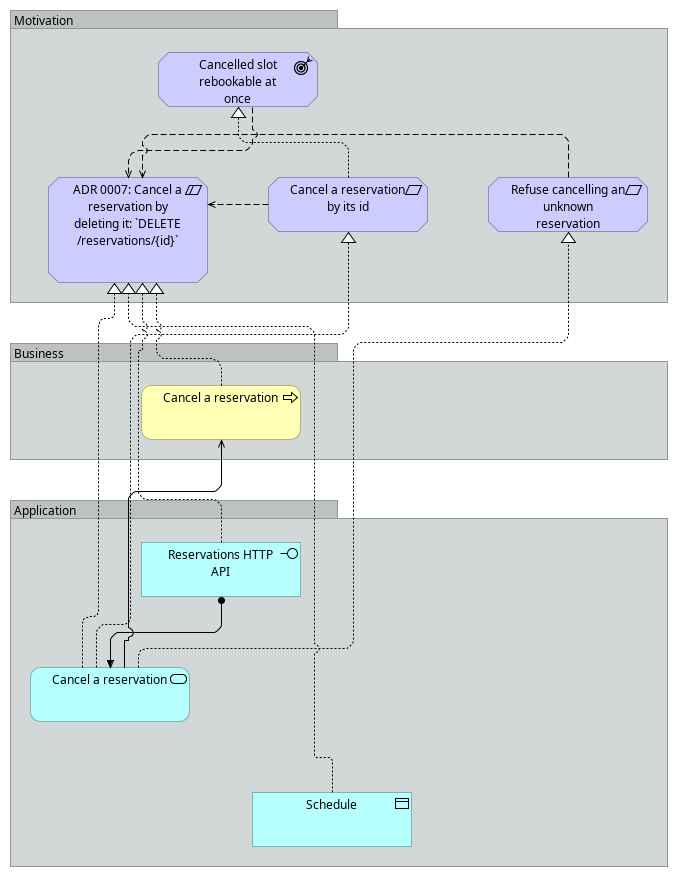

<!-- Generated from docs/architecture/model.xml (id-mot-adr-0007) by `just model-docs`. Do not edit: change the model, see docs/adr/template.md. -->
# 0007. Cancel a reservation by deleting it: `DELETE /reservations/{id}`

- Status: Accepted
- Date: 2026-11-15
- Issue: #17 (stories #18, #19)
- Deciders: human approver (plan approved at gate 1 on 2026-11-15), architect agent
- ArchiMate elements: `id-app-data-schedule`, `id-app-intf-reservation-api`, `id-app-svc-cancel`,
  `id-bus-proc-cancel`, `id-mot-out-rebook`, `id-mot-req-cancel`, `id-mot-req-cancel-refused`
- Released in: v0.2.0

## Elements this decision applies to

Clickable version:
[report](https://num-bbro.github.io/rust-factory/report/id-model-factory/views/id-view-adr-0007.html)

## Context and problem
Customers who can no longer come have no way to free their slot
([`id-mot-drv-blocked-slots`](../togaf/A-architecture-vision.md#id-mot-drv-blocked-slots)). Epic #17
asks that a customer can cancel a reservation by its id, and measures success as "a cancelled slot
can be booked again immediately"
([`id-mot-out-rebook`](../togaf/A-architecture-vision.md#id-mot-out-rebook)). We must decide what
"cancel" means for the stored data and what the HTTP API looks like, both for success (story #18,
[`id-mot-req-cancel`](../togaf/A-architecture-vision.md#id-mot-req-cancel)) and for an id that does
not exist or was already cancelled (story #19,
[`id-mot-req-cancel-refused`](../togaf/A-architecture-vision.md#id-mot-req-cancel-refused)).
Refunds, notifications and cancellation deadlines are out of scope.

## Decision drivers
- The freed slot must be bookable at once, with no extra rule in the overlap check.
- Smallest change that meets the stories: the domain already has `Schedule::cancel`, which removes
  the reservation and answers `NotFound` for an unknown id.
- The API stays consistent with the existing `POST /reservations` resource and its `{error}` body
  for failures.
- A customer must be told clearly when nothing was cancelled (story #19).

## Options considered
1. **Remove the reservation; `DELETE /reservations/{id}` → `204 No Content`; unknown id → `404 Not
   Found` with `{error}`.**
2. **Soft delete: keep the reservation with status "cancelled" (history)**: the overlap check and
   every later query must skip cancelled reservations; storage grows; nobody asked for the history.
3. **Return `200 OK` with a body** (the cancelled reservation or its slot): more to specify and
   test; the client already knows what it cancelled.
4. **Idempotent delete: `204` also for an unknown or already-cancelled id**: simple for retrying
   clients, but a typo in the id would look like success, which contradicts story #19.

For an id that is not a number at all (e.g. `/reservations/abc`), a separate choice:

- **A. `400 Bad Request` from the framework's typed path extractor**, plain-text body, no custom
  handling.
- **B. `404 Not Found` with `{error}`**, consistent with "unknown id → 404".

## Decision
Chosen: **option 1**, because it is what the domain already does (`Schedule::cancel`), it frees the
slot with no change to the overlap rule, it fits the REST resource that `POST /reservations`
creates, and it gives a clear refusal for ids that do not exist.

- `DELETE /reservations/{id}` on the reservation API
  ([`id-app-intf-reservation-api`](../togaf/C-information-systems-architecture.md#id-app-intf-reservation-api)),
  realised by a new cancel use case in `crates/application`
  ([`id-app-svc-cancel`](../togaf/A-architecture-vision.md#id-app-svc-cancel)).
- Success: `204 No Content`, no body.
- Unknown id, or an id that was already cancelled: `404 Not Found` with the existing `{"error":
  "..."}` body. Cancelling twice therefore gives `404` the second time.
- Cancelling removes the reservation from the schedule
  ([`id-app-data-schedule`](../togaf/C-information-systems-architecture.md#id-app-data-schedule)).
  No history is kept.
- Storage failures map to `503 Service Unavailable` with `{error}`, reusing the mapping `POST
  /reservations` already has. *Beyond the plan approved at gate 1; needs the human's sign-off on
  this ADR.*
- A non-numeric id: **option A**. A non-numeric id is answered `400 Bad Request` by the framework's
  typed path extractor, with a plain-text body (not `{error}`); no custom handling. Option B was
  rejected because a malformed id is a client error distinct from a well-formed id that does not
  exist, and custom handling adds code for no user value. *Beyond the plan approved at gate 1; needs
  the human's sign-off on this ADR.*

## Consequences
- Good: no domain change; the use case and the HTTP handler are thin; the acceptance scenarios of
  #18 and #19 map one to one onto status codes.
- Good: the overlap check stays the only rule for booking, so a cancelled slot is free at once.
- Bad: no record that a reservation ever existed once it is cancelled: no audit trail, no "no-show"
  statistics, and no way to undo a cancellation. If such a need appears, a new ADR supersedes this
  one (likely option 2).
- Bad: a client that retries a successful `DELETE` (e.g. after a timeout) sees `404`; it must treat
  `404` after its own earlier attempt as "already cancelled".
- Bad: anyone who knows a reservation id can cancel it; there is no authentication in the sample
  domain yet. Out of scope of #17.
- Bad: error bodies are not uniform: rule, not-found and storage errors carry `{error}`, while
  requests the framework rejects (a non-numeric id, malformed JSON) get a plain-text body.
- Bad: reservation ids are unique only within one running instance. Storage is in memory
  ([`id-app-comp-db`](../togaf/C-information-systems-architecture.md#id-app-comp-db)), so ids start
  again from 1 after a restart, redeploy or rollback, and an old id held by a client may then name a
  different reservation.
- Known risk: concurrent requests can lose or duplicate reservations, because the use cases load the
  schedule, change it and save it without atomicity. Cancel adds a second writer: a concurrent book
  and cancel can bring a cancelled reservation back or lose a booking. Tracked as bug #26; not fixed
  by this epic.
- Follow-up: implementation in the task issues under stories #18 and #19.

## Notes
- 2026-11-15: the known risk above (bug #26) is resolved by ADR 0008
  ([`id-mot-adr-0008`](0008-atomic-schedule-update-through-the-port.md)): every change to the
  schedule now goes through one atomic `update` operation on the repository port.
