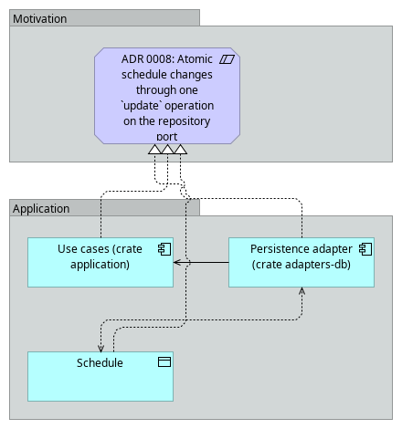

<!-- Generated from docs/architecture/model.xml (id-mot-adr-0008) by `just model-docs`. Do not edit: change the model, see docs/adr/template.md. -->
# 0008. Atomic schedule changes through one `update` operation on the repository port

- Status: Accepted
- Date: 2026-11-15
- Issue: #26 (bug), #37 (task)
- Deciders: human approver (option A approved at gate 1 on 2026-11-15), hard worker agent
- ArchiMate elements: `id-app-comp-application`, `id-app-comp-db`, `id-app-data-schedule`
- Released in: v0.2.1

## <a id="id-view-adr-0008"></a>Elements this decision applies to



Clickable version:
[report](https://num-bbro.github.io/rust-factory/report/id-model-factory/views/id-view-adr-0008.html)

## Context and problem
Both use cases (`BookSlot`, `CancelReservation`) loaded the schedule through the
`ScheduleRepository` port, changed the copy, and saved it back. The in-memory adapter locked its
mutex separately for `load` and for `save`, so two concurrent requests could load the same schedule
and the second `save` overwrote the first. Bug #26 lists the effects: a booking that answered `201`
disappears, two bookings get the same id, the same slot is accepted twice, and a cancelled
reservation comes back. The fix must make each change atomic without putting infrastructure into
`application` (ADR 0003) and without changing the HTTP behaviour (ADR 0007).

## Decision drivers
- Correct under concurrency: no lost, duplicated or resurrected reservation, whatever the timing.
- The rule stays in one place: the port's contract, so every adapter (in memory today, a database
  later) must provide atomicity, and no use case can forget it.
- `application` stays free of infrastructure crates and of locking policy.
- Smallest change: use-case `execute` signatures, `BookingError` behaviour and the HTTP API stay as
  they are; `crates/app` does not change.

## Options considered
1. **(A) One atomic update operation on the port**: the port runs a caller-supplied change on the
   current schedule and stores the result as one step; `load` and `save` are removed.
2. **(B) Optimistic concurrency**: `load` returns a version, `save` fails if the version changed,
   and the use cases retry.
3. **(C) A shared lock inside the use cases**: the use cases hold a mutex across load, change and
   save.
4. **(D) A lock in the HTTP adapter**: handlers serialise all requests that touch the schedule.

## Decision
Chosen: **option A**, because it puts atomicity in the port's contract, where every adapter must
honour it and no caller can bypass it, and it is the least code: one method replaces two. `load` and
`save` are removed rather than kept alongside, since nothing reads the schedule without writing it,
so load–change–save cannot be written again by accident.

The operation, in `crates/application`:

```rust
fn update<T, E, F>(&self, change: F) -> Result<T, E>
where
    F: FnOnce(&mut Schedule) -> Result<T, E>,
    E: From<RepositoryError>;
```

- **Generic closure, returning `T`**: each use case returns what its change produces (the new
  `ReservationId`, or `()`), with no captured out-variables.
- **The caller's error type `E`, with `E: From<RepositoryError>`**: a rule error passes through
  unchanged and a storage failure is converted into the same type, so the use cases keep returning
  `BookingError::Rule` / `BookingError::Storage` exactly as before, with no nested
  `Result<Result<…>>` and no new error enum.
- **Commit only on success**: if the change returns `Err`, nothing is stored, *even if the change
  modified the schedule before failing*. The in-memory adapter
  ([`id-app-comp-db`](../togaf/A-architecture-vision.md#id-app-comp-db)) holds its mutex for the
  whole operation, applies the change to a copy and swaps the copy in only on `Ok`. The copy costs
  one clone per change (the old `load` cloned too) and also leaves the stored schedule intact if a
  change panics.
- **A poisoned mutex is a `RepositoryError`** (answered `503` by the HTTP adapter), never a panic.

## Consequences
- Good: concurrent books and cancels on one host are serialised by the store; the concurrency test
  in `crates/adapters-db/tests/concurrency.rs` checks the final state of many threads booking,
  cancelling and racing for the same slots, and fails on the old load–change–save code.
- Good: a database adapter maps `update` onto one transaction (read, change, write, commit; roll
  back on `Err`), and the contract tells it so.
- Bad: the trait is no longer object-safe (`dyn ScheduleRepository` is impossible) because `update`
  is generic. Nothing uses it as a trait object; the HTTP adapter and `crates/app` are generic over
  the repository.
- Bad: if a change panics, the stored schedule stays intact (the change ran on a copy), but the
  mutex is poisoned: every later `update` returns `RepositoryError` and every request is answered
  `503` until the process restarts. This cannot happen with today's domain code, which returns
  errors and does not panic. Option not taken: recovering the lock with `PoisonError::into_inner`
  would be safe, because the stored data is always consistent; it is not done here, so that a panic
  stays visible as a failure instead of being silently passed over. A future ADR can change this.
- Bad: the change closure is synchronous and runs while the store is locked; it must stay short and
  must not call the repository again (the mutex is not re-entrant, so that would deadlock). An async
  database driver would need a new port shape and a new ADR.
- Bad: every change clones the whole schedule. Fine for one day's reservations; revisit if the
  schedule grows large.
- Out of scope: each host keeps its own in-memory schedule, so hosts do not share reservations and a
  restart empties them (ADR 0007); the HTTP handlers run the synchronous use case on the async
  worker thread, which briefly blocks that thread while the store is locked.

## Option details
- **(B) Optimistic version check with retry**: needs a version in the port and a retry loop (with a
  limit, and an error when it is reached) in every use case; under contention requests spin and can
  still fail. More code and more behaviour to test, for a store that can simply lock.
- **(C) A shared lock inside the use cases**: puts locking policy into `application`, protects only
  callers that share that lock (two `BookSlot` values, or another process, would not), and leaves
  load–change–save in the port for the next caller to misuse.
- **(D) A lock in the HTTP adapter**: protects only HTTP callers; any other driving adapter (a CLI,
  a queue consumer) would bring the bug back, and correctness would depend on how the binary is
  wired rather than on the port.
