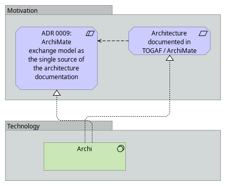

<!-- Generated from docs/architecture/model.xml (id-mot-adr-0009) by `just model-docs`. Do not edit: change the model, see docs/adr/template.md. -->
# 0009. ArchiMate exchange model as the single source of the architecture documentation

- Status: Accepted
- Date: 2026-11-16
- Issue: #41 (change request), #42 (task: spike and this ADR)
- Deciders: human approver (requirements confirmed one at a time and plan approved on 2026-11-16;
  sign-off at gate 1 by merging this ADR), architect agent
- ArchiMate elements: `id-mot-req-togaf`, `id-tech-sw-archi`
- Supersedes: ADR 0002

## Elements this decision applies to

Clickable version:
[report](https://num-bbro.github.io/rust-factory/report/id-model-factory/views/id-view-adr-0009.html)

## Context and problem
Today the architecture documentation has three hand-edited sources: the model in
`docs/architecture/model/*.csv` (Archi's CSV layout plus a `views.csv` this repo invented, see ADR
0002), the TOGAF narrative in `docs/togaf/*.md`, and the ADRs in `docs/adr/*.md`. No tool other than
this repo's scripts can read that set, and diagrams exist only as build output: no document shows
one, and no diagram leads to the decisions or documents behind its boxes.

The human's requirement (2026-11-16, change request #41): the maintained form must be a standard,
self-describing ArchiMate format that other software can read, and reading must work both ways: a
document shows its diagrams, and a diagram leads to the decisions, documents and releases behind
each box ([`id-mot-req-togaf`](../togaf/00-preliminary.md#id-mot-req-togaf)).

## Decision drivers
The five requirements the human confirmed on 2026-11-16:
1. **One edited source**: the Open Group *ArchiMate Model Exchange File Format* (XML); the CSV files
   are removed.
2. **ADR and TOGAF text live in the model**; Markdown pages are generated (with diagrams and catalog
   tables), never hand-edited.
3. **Any standard tool** can read it: validated against the official schema on every change; nothing
   Archi-specific.
4. **Read it in both places**: generated Markdown and images committed to the repo, and a public
   GitHub Pages site with clickable diagrams.
5. **Archi is view-only for now**; agents edit the XML in PRs. A round trip through Archi must stay
   possible later.

Also, as before: agents edit it reliably with reviewable diffs, builds run unattended in CI, and
Thai text works.

## Options considered
1. **Exchange XML as the single source, with ADRs, TOGAF documents and releases as model elements,
   and generated Markdown** (chosen).
2. **Keep the CSV source; generate the exchange XML and commit it.** Other tools could read the
   committed file, but it would be a copy of a tool-specific source: two files to keep in step, and
   the edited form would still carry no meaning outside this repo. Fails requirement 1.
3. **Archi's native `.archimate` file as the source.** Readable only by Archi (and jArchi/coArchi),
   not a standard; noisy diffs with Archi's random folder IDs and style data. Fails requirement 3.
4. **Exchange XML for the model, Markdown for ADRs and TOGAF kept outside it.** Smallest change, but
   the link from a box to its decisions and documents would exist only as text conventions that no
   ArchiMate tool understands. Fails requirements 2 and 4 (the "both ways" part).

How to represent a decision (ArchiMate has no "decision" element type):
- **`Constraint`** (chosen): "a factor that limits the realization of goals", which is what an
  accepted ADR is; visibly different from `Requirement`; every core structure or behaviour element
  may *realize* it and every element may *influence* it (checked against Archi's
  `relationships.xml`, see the spike).
- *Requirement*: already used for user stories and business requirements; decisions would be
  indistinguishable from them in views and catalogs.
- *Principle*: too general. A principle applies to any system in a context; a decision is specific
  to one problem and one choice. (The relationship rules would allow it: Realization from an
  ApplicationComponent to a Principle is allowed.)
- *Assessment*: an assessment is the *outcome of analysing* a driver, not the choice made; core
  elements may only associate with it or influence it (no Realization), so "this component
  implements ADR N" cannot be said.

## Decision
Chosen: **option 1**, because it is the only option that meets all five requirements, and the spike
(below) shows that the pinned Archi 5.11.0 and the official schema accept everything it needs
without leaving the standard.

### The source file and its canonical form
- One file, `docs/architecture/model.xml`, in namespace
  `http://www.opengroup.org/xsd/archimate/3.0/` with
  `xsi:schemaLocation="http://www.opengroup.org/xsd/archimate/3.0/
  http://www.opengroup.org/xsd/archimate/3.1/archimate3_Diagram.xsd"`. The format has no include
  mechanism, so a split source would not be importable by other tools.
- **Canonical form** = what `just model-fmt` writes: UTF-8, LF, 2-space indent, fixed attribute
  order, sections in schema order, items sorted by identifier (parallel additions land in different
  places). `just model-fmt --check` parses, serialises and byte-compares. The spike fixed these
  rules of the form (each is either required by the schema or avoids a difference between the schema
  and Archi):
  - every name, label, documentation and value carries `xml:lang="en"`;
  - an empty `documentation` is omitted, not written empty;
  - `documentation` text has no trailing newline (Archi's export strips it; the generator adds one
    when it writes a page);
  - text is XML-escaped; no CDATA sections and no comments (a comment would not survive a
    parse-and-serialise round);
  - `Access` relationships always state `accessType` (Archi reads a missing one as `Write`, the
    schema's default is `Access`);
  - property definitions have stable identifiers `propid-<slug>`, and every definition is used.
- Identifiers stay our `id-<layer>-<kind>-<slug>` IDs: they are valid `xs:ID`s, and Archi keeps
  every one of them on import.

### Views: agents list members, the formatter lays out
- **Agents never place boxes.** In a view they add only `<node xsi:type="Element"
  elementRef="id-…"/>`; `just model-fmt` computes the node identifiers, bands, nesting, coordinates
  and connections, reusing `scripts/archimate/layout.py` and the view emission of
  `build_exchange.py`. The schema requires `identifier`, `x`, `y`, `w` and `h` on every node, so the
  bare form is formatter input only: the committed (formatted) file always has them, and schema
  validation runs on it.
- A view property `Layout = manual` tells the formatter to leave a hand-arranged view alone (for
  later, when Archi editing is allowed).

### Validation, in `just model-check` (no Archi start, so it stays in the CI `gates` job)
- **Official schema** with `xmllint --noout --nonet --schema archimate3_Diagram.xsd`, the XSDs read
  from the pinned Archi install (`plugins/org.opengroup.archimate.xmlexchange_*.jar`, `xsd/`), with
  an XML catalog that maps the `xml.xsd` import to the copy in the same jar. Their sha256 values are
  pinned in `tools/archi.env`; they are byte-identical to the Open Group's published 3.1 schemas.
  Same principle as `relationships.xml` (ADR 0002 amendment): no second copy in the repo.
- `bootstrap.sh` installs `libxml2-utils` (Ubuntu) / `libxml2` (Arch); `just doctor` reports it.
- Kept and pointed at the XML: `check_relationships.py` (relationship rules from Archi's
  `relationships.xml`), the ID convention, document references.
- New: canonical form, generated pages are current, image lock (below), every `View` property names
  an existing view, and every diagram connection joins nodes of its relationship's ends (neither the
  schema nor Archi checks the last two).
- `build.sh` validates with `xmllint` before starting Archi and runs Archi under a timeout: Archi's
  importer hangs instead of exiting when its own schema check fails.

### ADRs → one `Constraint` element each
- Identifier `id-mot-adr-NNNN`, name `ADR NNNN: <title>`; properties `Status`, `Date`, `Issue`,
  `Deciders`, `File` (the generated page). The full text, as Markdown, is the `documentation`
  (Archi's report renders it, other tools show plain text).
- Links replace today's `ADR` property rows and the "ArchiMate elements" header lines:
  **Realization** from the core elements that implement the decision, **Influence** from motivation
  elements that shaped it. "Supersedes" is a **directed Association named `supersedes`** from the
  new ADR to the old one, plus `Status = Superseded by NNNN` on the old one. Amendments stay
  appended, dated sections of the text, as now.

### TOGAF documents → one `Deliverable` element each
- Identifier `id-impl-del-<slug>` (e.g. one per ADM phase); the narrative is the `documentation`;
  properties `File`, `Phase`, and an ordered, repeated `View` naming the views that belong to the
  document (the exchange format has no relationship from an element to a view; Archi keeps repeated
  properties in order).
- The generated page is the narrative (IDs become links) plus, for each view: the image, the view's
  documentation, a link to its clickable page on the site, and a **catalog table** (id, name, type,
  decisions, issues, crate/code, release, other documents). These are TOGAF's artifacts (catalogs
  and diagrams) inside the deliverable.

### Releases → one `Plateau` element each
- Identifier `id-impl-plat-vX-Y-Z`, **Aggregation** to the elements and ADR Constraints it
  delivered, so a release is a box in a diagram and a column in catalogs. ArchiMate does not allow a
  Plateau to aggregate a Deliverable, Driver, Principle, Stakeholder, Assessment, Value, Meaning,
  Work Package, Gap or Implementation Event; for those, a release uses Association.

### Generated output
- One standard-library generator, `scripts/archimate/gen_docs.py`, writes `docs/adr/*.md`,
  `docs/adr/README.md` and `docs/togaf/*.md`, each with a "generated, do not edit" header; `--check`
  re-renders and diffs (fails on stale or orphan files).
- **Images:** Archi's PNGs are committed to `docs/architecture/views/` with a `views.lock` holding,
  per view, a hash of the view's rendering inputs and of the PNG, and its dimensions. `just model`
  writes both; `model-check` fails with "run `just model`" when a view changed without its image.
  PNG bytes are not reproducible across displays (spike item 4), so checks compare the lock, never
  re-rendered bytes.
- **Site:** `.github/workflows/pages.yml` on push to `main` publishes the rendered documents and
  Archi's HTML report (boxes are clickable there) with the official Pages actions. PRs get the same
  site as a downloadable artifact.

### Archi is view-only for now
The human opens `docs/architecture/model.xml` in Archi (File › Import › Open Exchange File) to look,
not to edit. A later "edit in Archi" feature would export, then normalise with `just model-fmt`;
spike item 5 lists what it would have to undo.

### Refinements to the approved plan found by the spike
Rules that go beyond the plan in #41, collected here (details in the sections above and in the
spike):
- `xml:lang="en"` on every name, label, documentation and value.
- An empty `documentation` is omitted.
- No trailing newline in `documentation` text.
- No XML comments (and no CDATA).
- `Access` relationships always state `accessType`.
- Every property definition is used.
- `xsi:schemaLocation` is always written.
- The formatter generates node identifiers (as well as coordinates and connections).
- Two extra checks: every `View` property names an existing view; every diagram connection's ends
  match its relationship's ends.
- `build.sh` runs `xmllint` before Archi, and Archi under a timeout.
- A Plateau uses Association where ArchiMate does not allow Aggregation.
- The "ArchiMate elements" header lines of the ADRs are replaced by relationships, as the `ADR`
  property rows are.
- `views.lock` also stores each view's dimensions; checks never compare re-rendered bytes, and `just
  model` always renders under Xvfb.
- Archi's HTML report is not reproducible and is never compared.
- Size estimate: about 125–150 KB / 2,000–2,200 lines (plan: 110 KB / 1,700 lines).
- "PNG dimensions equal on dev and CI" moves from step 0 to step 4.

## Consequences
- Good: one standard file holds the whole architecture; any conformant tool can import it, and the
  schema check on every PR keeps it conformant.
- Good: reading works both ways: a document page shows its diagrams and catalogs; on the site and in
  Archi, a box leads to its decisions (Constraints), documents (Deliverables) and releases
  (Plateaus).
- Good: no ADR text, TOGAF text and model can drift apart any more: there is one copy.
- Trade-offs the human accepted by approving the plan:
  1. **Prose is written inside XML.** PRs show each text change twice: in `model.xml` and in the
     generated page (the readable one).
  2. **Model changes are serialised.** With one source file, architecture tasks run one after
     another, not in parallel (`/implement` treats `model.xml` as one shared area).
  3. **On GitHub itself, diagrams are pictures;** the catalog table under each diagram gives the
     links. Clicking boxes works on the Pages site and in Archi.
  4. **One-time re-layout** of the four existing diagrams (sorted order changes box positions).
  5. **Size and effort:** `model.xml` grows to about 110 KB / 1,700 lines by the plan's estimate
     (the spike measures about 125–150 KB / 2,000–2,200 lines, see item 6); about 8 PRs, mostly hard
     (Opus) tasks; roughly USD 30–40 at list price.
- Bad: agents must write Markdown as escaped XML text (`&lt;`, `&amp;`); the formatter and the
  generated page make mistakes visible, but diffs of long text are less pleasant than in a `.md`
  file.
- **Line breaks inside paragraphs: decided by the human on 2026-11-16, option (A).** Archi's HTML
  report renders every single line break in a documentation text as a ` ` (spike item 1), and
  the ADRs and TOGAF files were hard-wrapped at about 100 characters. The two options put to the
  human:
  - **(A) Unwrap each paragraph to one line at migration.** The text then reads well in Archi's
    report, on the site and in other tools. The lossless proof of step 3 and 5 then compares
    whitespace-normalised text, not the sha256 of the bytes.
  - **(B) Keep the text byte-identical.** The sha256 proof planned in #41 holds as written, and the
    report (and so the site's element pages) shows ragged paragraphs.
  - **Decision: (A).** Each paragraph and each list item is stored in the model as one line; the
    generated pages wrap them again at 100 characters, so they read and diff as before. This
    replaces the open question that stood here until step 3.
- Follow-up (each one task issue under #41, one PR each; `main` stays green after each):
  1. Canonical reader/writer and `just model-fmt`, schema validation, xmllint in bootstrap and
     doctor, tests on fixtures.
  2. Cutover: `model.xml` replaces the CSV; `build.sh` and `check_relationships.py` read XML; the
     CSV files and `build_exchange.py` are deleted; lossless proof; rules updated. `build.sh`
     validates with `xmllint` before starting Archi and runs Archi under a timeout. The intended
     access type (Read / Write / ReadWrite / Access) of each of the 7 `Access` relationships is
     stated explicitly; the choice per relationship is put to the human in that PR.
  3. ADRs into the model (including this one); generator and check; templates.
  4. Committed view images and `views.lock`; check that PNG dimensions are equal on the dev machine
     and on CI (moved here from step 0, see spike item 4).
  5. TOGAF documents into the model; pages with diagrams and catalogs.
  6. Release Plateaus (v0.1.0, v0.2.0, v0.2.1).
  7. Pages workflow and site (human step: Settings › Pages › Source = "GitHub Actions").
  8. Sweep: skills, reviewer rules, CONTRIBUTING, memory.

## Spike (2026-11-16, Archi 5.11.0, libxml2 2.15.4, Arch Linux)
Throwaway work in a temporary directory, nothing of it committed. Input: today's generated
`build/architecture/model.xml` (53 elements, 69 relationships, 4 views) plus, by hand: Constraints
for ADR 0002 (has a table), ADR 0008 (has a Rust code block with `Result<T, E>`, lists, emphasis)
and a stub ADR 0009; a Deliverable holding the full text of
`docs/togaf/C-information-systems-architecture.md`; a Plateau `Release v0.2.1`; a Realization from
[`id-app-comp-application`](../togaf/A-architecture-vision.md#id-app-comp-application) to the ADR
0008 Constraint; an Influence from [`id-mot-req-togaf`](../togaf/00-preliminary.md#id-mot-req-togaf)
to the ADR 0002 Constraint; a directed Association `supersedes` from ADR 0009 to ADR 0002;
Aggregations from the Plateau to
[`id-app-comp-application`](../togaf/A-architecture-vision.md#id-app-comp-application) and to the
ADR 0008 Constraint; eight new property definitions (`propid-status`, `propid-file`, `propid-view`,
`propid-layout`, …), a repeated `View` property, properties on the existing view
[`id-view-motivation`](../togaf/00-preliminary.md#id-view-motivation), a new hand-placed view
showing all of the above, and `xsi:schemaLocation`. Result: 58 elements, 74 relationships, 5 views,
84,394 bytes, 1,148 lines.

### 1. Archi imports the hand-maintained file: yes
- Imported with the exact command line of `scripts/archimate/build.sh` (`--abortOnException
  --xmlexchange.import … --saveModel … --html.createReport …`): "Validated!", "XML Imported!",
  "Report generated!", exit 0, in 3.5 s.
- Every element, relationship, view, node and connection identifier is kept in `model.archimate`
  (296 identifiers in, all present). Property *definition* identifiers are not kept: the native
  format stores properties as key/value pairs. The repeated `View` property keeps its order;
  properties on views are kept and shown on the view's report page; `supersedes` is stored as a
  named, directed Association.
- Documentation is kept byte for byte (sha256 of the text equal before and after import).
- The report page of a Constraint **renders the Markdown**: headings, lists, emphasis, inline code,
  the fenced Rust block (as `<pre><code class="language-rust">`, with `<`, `>` and `&` correct) and
  the ADR 0002 table (as an HTML `<table>`). All 62 element pages with documentation are rendered
  the same way. Each single line break in the source becomes a ` `, so hard-wrapped paragraphs
  show ragged lines (open question under Consequences).
- The view image map links every box to its element page (`<area … href="../elements/<id>.html">`, 7
  of 7 boxes on the spike view). An element page lists its relationships, so
  [`id-app-comp-application`](../togaf/A-architecture-vision.md#id-app-comp-application) links to
  the ADR 0008 Constraint and to the Plateau.
- All 74 relationships are allowed by Archi's `relationships.xml` (checked with the rules loader of
  `check_relationships.py`). Rules that shape the mapping: Realization to a Constraint is allowed
  from every core structure and behaviour element, but not from motivation elements; Influence to a
  Constraint is allowed from every element; Constraint to Constraint allows Association,
  Aggregation, Composition, Influence and Specialization; a Plateau may not aggregate a Deliverable,
  Driver, Principle, Stakeholder, Assessment, Value, Meaning, Work Package, Gap or Implementation
  Event.
- Adding the Constraint, Deliverable and Plateau, and properties on a view, did not change the
  images of the four existing views (PNG bytes equal to the plain `just model` build).

### 2. Official schema, offline: yes, on libxml2 2.15.4 and 2.9.14
- Command (catalog file with one entry, `<system systemId="http://www.w3.org/2001/xml.xsd"
  uri="file:///…/xsd/xml.xsd"/>`, in the OASIS catalog namespace): `XML_CATALOG_FILES=catalog.xml
  xmllint --noout --nonet --schema xsd/archimate3_Diagram.xsd model.xml` → "validates", exit 0, for
  both today's generated file and the spike file. Without the catalog the schema does not compile
  (`archimate3_Model.xsd` imports `http://www.w3.org/2001/xml.xsd`, and `--nonet` forbids fetching
  it), so the catalog is required, not optional.
- Source:
  `~/.local/opt/archi-5.11.0/plugins/org.opengroup.archimate.xmlexchange_5.11.0.202610161626.jar`,
  directory `xsd/`. sha256:
  - `archimate3_Diagram.xsd` 6419080f4c4bc43b4a7b8acf870146a7bae6c3487a3ce08d3c521c028ea6056e
  - `archimate3_View.xsd` d708ce176403034b1229b892712cfd69660aefe17da4cc54acea1ac35e4a9854
  - `archimate3_Model.xsd` dd451abe3e3193f91dd9544b279af9bbbf17e75ff1ef86f65ad52b3f8cd29794
  - `xml.xsd` (W3C, same jar) f0fa306f2951fb1a477220eb7bdeaa35959c8d0224258f2104d3c4724ba746f7

  The three `archimate3_*.xsd` files are byte-identical to the ones published at
  https://www.opengroup.org/xsd/archimate/3.1/ (same sha256, empty `diff`, fetched 2026-11-16).
- libxml2: `xmllint` 2.15.4 here (Arch). Ubuntu 24.04, the CI runner, ships libxml2 2.9.14. No
  Ubuntu image was available offline, so the same validation was run with libxml2
  2.9.14+dfsg-1.3~deb12u6 (Debian 12, a local builder image, no network) through a 25-line C program
  making the same library calls as `xmllint --nonet --schema` (catalog, no-network entity loader,
  schema parse, validate): the spike file validates; a bare view node, wrong child order and an
  unknown relationship target are rejected; without the catalog the schema does not compile. Neither
  `.github/actions/setup` nor `bootstrap.sh` installs `xmllint` today (`libxml2-utils` is not in the
  Ubuntu package list); step 1 adds it. Whether the runner image happens to have it preinstalled was
  not checked and should not be relied on.

### 3. Strict schema versus Archi
One deviation per file, each validated with the command of item 2 and imported with Archi's command
line (Archi validates with its own Xerces copy of the same XSDs before importing):

| Deviation | xmllint | Archi | Rule for the canonical form / our checks |
|---|---|---|---|
| `documentation` before `name` in an element | rejects | rejects | children in schema order: name, documentation, properties |
| `propertyDefinitions` before `relationships` | rejects | rejects | sections in schema order |
| view `properties` after the nodes | rejects | rejects | view: name, documentation, properties, then nodes and connections |
| element without `name` | rejects | rejects | every element, view and property definition has a name |
| bare view node (no `identifier`, `x`, `y`, `w`, `h`) | rejects | rejects | formatter input only; the committed file is formatted |
| node with identifier but no coordinates | rejects | rejects | same |
| node `elementRef` pointing at a relationship | rejects | rejects | — (schema key/keyref) |
| property referring to an unknown definition | rejects | rejects | — |
| property referring to an element instead of a definition | rejects | rejects | — |
| empty `<properties/>` | rejects | rejects | omit `properties` when there are none |
| relationship to an unknown element | rejects | rejects | — |
| duplicate identifier | rejects | rejects | — |
| identifier with `:` and a space | rejects | rejects | ID convention check gives the clearer message |
| unknown element type (`Decision`) | rejects | rejects | decisions are `Constraint` |
| no `xml:lang` | accepts | accepts | always write `xml:lang="en"` (one form, matches Archi's export) |
| `xml:lang="th"` on documentation | accepts | accepts | Thai text needs no language tag; keep `en` |
| empty `<documentation>` (either spelling) | accepts | accepts, stores nothing | omit it |
| two `documentation` entries, same language | accepts | keeps only the first | at most one per language |
| unused property definition | accepts | accepts | our check: every definition is used |
| CDATA section | accepts | accepts | escape instead, one form |
| XML comment | accepts | accepts | none (lost by the formatter) |
| no `xsi:schemaLocation` | accepts | accepts | always write it (self-describing file) |
| Assignment from a component to a Constraint (not allowed by ArchiMate) | accepts | accepts, stores it | `check_relationships.py` |
| diagram connection whose ends are not the relationship's ends | accepts | accepts, stores it | our check (the formatter generates connections) |

Archi never accepted a file the schema rejects. When its own validation fails, Archi prints the
error and then **hangs** instead of exiting (killed after 60 s), with or without a display. Hence
the rules: validate with `xmllint` first, start Archi only on a valid file, and under a timeout.
Things both accept that our own checks must catch: a relationship type ArchiMate does not allow, a
diagram connection whose ends are not the relationship's ends (Archi stores it as is), and a `View`
property naming a view that does not exist (properties are plain strings).

### 4. Diagram images
- Same machine, same display mode: **byte-identical**. Two runs under Xvfb gave identical PNGs, and
  two runs on the real display gave identical PNGs (also identical to `just model`).
- Same machine, real display versus Xvfb: **bytes differ**, dimensions equal. 0.6–1.8 % of the
  pixels differ, all inside text (anti-aliasing). So bytes depend on the display, not only on the
  machine: `just model` should always render under `xvfb-run` for a stable local result (step 4).
- Dimensions (both modes):
  [`id-view-layered`](../togaf/C-information-systems-architecture.md#id-view-layered) 1299×1028,
  [`id-view-lifecycle`](../togaf/B-business-architecture.md#id-view-lifecycle) 1010×432,
  [`id-view-motivation`](../togaf/00-preliminary.md#id-view-motivation) 833×387,
  [`id-view-reservation-cancel`](../togaf/A-architecture-vision.md#id-view-reservation-cancel)
  1423×1246, spike view 620×375.
- Not established here: whether CI (Ubuntu 24.04, Xvfb, other fonts) gives the same dimensions; step
  4 compares a CI run with the lock.
- The HTML report itself is not byte-reproducible: the folder identifiers in `model.html` are random
  on every run. Adding `<organizations>` with fixed identifiers does not help (Archi still generates
  new folder identifiers, and the order of "used in views" rows on element pages then varies too).
  The site is therefore a build artifact and is never compared.

### 5. Round trip through Archi's export
`--xmlexchange.import spike.xml --xmlexchange.export out.xml --xmlexchange.exportLang en`; the
output validates, and exporting it again gives a byte-identical file (one normalising pass, then a
fixed point). Compared with the input (84 KB → 121 KB, 1,148 → 2,173 lines):
- Kept: every element, relationship, view, node and connection identifier; names, documentation text
  (apart from the trailing newline), property values and their order, view properties, node
  coordinates and sizes, relationship order, section order.
- Changed: elements are reordered (by Archi folder and then type, no longer by our order); property
  definitions are renumbered `propid-1`… in alphabetical order of their names; every node and
  connection gains a `<style>` block (fill and line colours and the machine's font, here `Sans`, 144
  blocks); attribute order on nodes changes; the trailing newline of each documentation is removed;
  `accessType="Write"` is added to every `Access` relationship that had none (7 today), which
  changes their meaning under the standard's default.
- So a later "edit in Archi" normaliser must: re-sort, map `propid-N` back to `propid-<slug>` by
  name, drop `<style>` unless the view is `Layout = manual`, and keep the explicit `accessType`.
  Nothing is lost that cannot be restored.
- Already true today: Archi shows the 7 `Access` relationships of the current model as *write*
  access, because the generated XML omits `accessType`; the cutover (step 2) should state the
  intended access type of each one.

### 6. Size
The 8 ADRs and 11 TOGAF files hold 43,761 bytes of text once XML-escaped (764 lines). Today's
generated file is 62,014 bytes / 783 lines. Adding the text, about 1 KB of element and property
markup per ADR, document and release, the relationships that replace today's ADR rows and header
lists, and the view nodes for the new elements gives about **125–150 KB and 2,000–2,200 lines** (the
upper end includes ADR 0009 itself, about 16 KB). This is somewhat above the plan's 110 KB / 1,700
lines and does not change the decision: the file stays far below what editors, `xmllint` and Archi
handle comfortably (the 84 KB spike file imports in 3.5 s).

### Requirements check
Every confirmed requirement can be met inside the standard. Nothing in the spike needed an
Archi-specific construct; the differences found are rules of our canonical form and our own checks,
listed above.

## Amendment 2026-11-16: as built in steps 1 and 2
Steps 1 (#44) and 2 (#46) built the tooling and the cutover. This amendment records the points
below, where the tooling as built refines the decision above; each is part of the decision from now
on. Anything not listed here is still decided by the text above, not by the code:
- **XML comments, processing instructions and a DOCTYPE are rejected** with a message naming them,
  not dropped. CDATA is accepted on input and written escaped.
- **Unused property definitions are dropped** by the formatter, with a note on stderr ("every
  definition is used" holds for the written file).
- **A missing `accessType` is written as `Access`** by the formatter (the schema's default), and the
  formatter prints a note on stderr naming the relationship, so the author sees it and can choose
  `Read`, `Write`, `ReadWrite` or `Access`. The committed file therefore always states the type;
  `model-check` cannot tell a chosen `Access` from a defaulted one, so the note is the only warning.
  The cutover states the type on all seven existing ones, and the human chooses them in the cutover
  PR.
- **Rejected for now**: `metadata`, `organizations`, `viewpoints`, `viewpointRef`, elements and
  attributes in foreign namespaces, and texts in a language other than `en`. A future normaliser for
  Archi exports must strip `organizations`, `metadata` and `<style>` (spike item 5) before
  formatting.
- **Views with `Layout = manual`** are copied as they are, so they are exempt from the `xml:lang`
  rule as well as from the layout; only their property-definition references are renamed.
- **`xml.xsd` is pinned too**: `tools/archi.env` holds four sha256 values (the three ArchiMate
  schemas and `xml.xsd`), and `xsd_check.py` fails when any of them differs.
- **Trailing whitespace**, not only a trailing newline, is removed from `documentation`; inner
  spaces and line breaks are kept.
- **An empty view** (no members) is valid and written without nodes.
- **View emission** lives in `scripts/archimate/exchange.py` (`add_diagram`, with `layout.py`);
  `build_exchange.py` and the CSV files are gone. `exchange.read` is the one reader the checks
  share.
- **The checks of `just model-check`**, in order: canonical form (`model_fmt.py --check`), schema
  (`xsd_check.py`), relationship rules (`check_relationships.py`), then `check_model.py`: the ID
  convention (before the cutover nothing checked it), every view member is an element, every diagram
  connection joins nodes of its relationship's ends (a plain line without a relationship, possible
  only in a `Layout = manual` view, is skipped), every `View` property names a view, every view's
  `viewpoint` is one of the `ViewpointsEnum` values of the pinned `archimate3_View.xsd` (the
  schema's viewpoint type is a union with `xs:string`, so it accepts any text; `build_exchange.py`
  had checked this against its own list), and every `` `id-…` `` in `docs/**/*.md` exists.
  `build.sh` runs all of them before Archi, also in `just model`. The checks for generated pages and
  the image lock come with steps 3–5.
- **New rule: the model's own identifier is `id-model-<slug>`** (today `id-model-factory`), next to
  `id-<layer>-<kind>-<slug>`, `id-rel-NNN` and `id-view-<slug>`; `CLAUDE.md` lists it.
- **Relationship types** are written without the `Relationship` suffix in the exchange format
  (`Serving`); `check_relationships.py` adds it to look up Archi's rules.
- The model's `Source` property now names `docs/architecture/model.xml`.
- The CI artifact `architecture-model` no longer carries a copy of `model.xml`: the source is in the
  repo.

## Amendment 2026-11-16: as built in step 3 (ADRs in the model)
Step 3 (#48) moved the nine ADRs into the model. As with the amendment above, these points refine
the decision:
- **Line breaks: option (A)**, decided by the human (see Consequences).
  `scripts/archimate/mdwrap.py` unwraps and wraps on block structure only, and knows which list
  items a line is inside: fenced code (at any indent, also inside nested list items), indented code,
  tables (with or without a leading `|`), headings, block quotes, HTML blocks and break lines are
  never joined or wrapped; a wrap breaks only at a single space, never before a word that would
  start a block and never after a backslash. What it does not support is refused, not guessed at: a
  tab in the indentation of a line outside fenced code, and a fence closed left of its list item's
  content. `gen_docs.py --check` fails when an ADR's paragraph or list item is spread over several
  lines.
- **ADR elements** are recognised by their identifier `id-mot-adr-NNNN`; the generator also checks
  their type (`Constraint`), name (`ADR NNNN: <title>`), the five properties, `File =
  docs/adr/NNNN-<slug>.md`, and that `Status = Superseded by NNNN` and the `supersedes` Association
  agree.
- **The header list is derived:** "ArchiMate elements" lists the sources of the Realization and
  Influence relationships to the ADR, sorted by identifier and in backticks; free text after the
  list (as in this ADR's header until step 3) has no place there and moves into the body when it
  matters. "Supersedes: ADR NNNN" and "Superseded by: ADR NNNN" come from the `supersedes`
  Association.
- **`docs/adr/README.md`** (the index) is generated too; its introduction lives in `gen_docs.py`.
  `docs/adr/template.md` stays hand-written: it is the guide for adding an ADR.
- **Orphans are reported, never deleted:** `just model-docs` writes the pages and fails on a
  `docs/adr/*.md` that no ADR element produces; deleting it is the author's step.
- **Document references** also cover the `` `id-…` `` cited inside any `documentation` text of the
  model.

## Amendment 2026-11-16: as built in step 4 (committed view images)
Step 4 (#50) committed the view images. As with the amendments above, these points refine the
decision:
- **Where and what:** `just model` copies Archi's PNG of each view from its HTML report
  (`report/<model id>/images/<view-id>.png`) to `docs/architecture/views/<view-id>.png` and writes
  `docs/architecture/views/views.lock`: a header comment, then one line per view, sorted by view id:
  `<view-id> <inputs sha256> <PNG sha256> <width>x<height>`. `scripts/archimate/views.py` does both
  and reads the PNG size from its IHDR header with the standard library.
- **Rendering inputs**, whose sha256 is the lock's first hash: one JSON text (keys sorted, compact,
  UTF-8) of the pinned `ARCHI_VERSION`, the view in canonical form without its `documentation` and
  `properties`, `[identifier, type, name]` of each element a node draws, and `[identifier, type,
  name, accessType, isDirected, modifier]` of each relationship a connection draws, and, only in a
  view with view references (`<viewRef ref="…"/>`, possible in a `Layout = manual` view),
  `[identifier, name]` of each view referred to, because Archi draws such a node with that view's
  name. The three relationship attributes go beyond the plan's "type and name" because they change a
  line's arrowheads or label. Documentation and properties of anything, and other views except the
  name of a view referred to, do not change a view's hash. `views.py` holds the definition and
  `scripts/archimate/tests/test_views.py` tests both directions.
- **Only what is out of date is rewritten:** a view keeps its committed image when its lock entry
  has the current input hash and the file has the locked sha256 and size; otherwise the fresh render
  replaces it, so `just model` also repairs an edited, deleted or foreign image, not only a changed
  view. The image and lock entry of a view that left the model are removed. Any other file in the
  folder is reported and fails the build, but is never deleted: as with orphan ADR pages, deleting
  it is the author's step. With nothing changed, a re-run leaves the working tree untouched.
- **Always Xvfb, and X11:** `build.sh` always runs Archi under `xvfb-run`, with `WAYLAND_DISPLAY`
  removed and `GDK_BACKEND=x11`: in a Wayland session GTK otherwise draws on the session's display
  despite `xvfb-run`, and the PNG bytes then differed from a build without a session. With this,
  repeated local builds give byte-identical PNGs.
- **The image check** (`views.py --check`) is the last check of `just model-check`. `just model`
  skips it before the build (the build is what brings the images up to date) and runs it after
  updating them. It fails, naming the view and saying "run `just model` and commit
  `docs/architecture/views/`", for a view without a lock entry or with another input hash, a missing
  PNG, a PNG whose sha256 or size differs from the lock (also a file that is not a PNG or is
  truncated), a lock entry without a view or the image of such a view, and a lock that is malformed,
  unreadable or not in its generated form. Any other file or folder there is reported with "delete
  it", since `just model` leaves it. It never renders and never compares pixels.
- **CI dimensions: equal.** The `architecture model` job runs `just model`, fails if that changed
  anything under `docs/architecture/views/`, then runs `just model-dims`, which compares the size of
  each PNG rendered on CI with `views.lock` (bytes are not compared) and fails when it compared
  nothing. On CI (Ubuntu 24.04 under Xvfb, PR #51) all four views had the sizes rendered on the dev
  machine (Arch Linux under Xvfb):
  [`id-view-layered`](../togaf/C-information-systems-architecture.md#id-view-layered) 1494×1028,
  [`id-view-lifecycle`](../togaf/B-business-architecture.md#id-view-lifecycle) 1010×432,
  [`id-view-motivation`](../togaf/00-preliminary.md#id-view-motivation) 980×387,
  [`id-view-reservation-cancel`](../togaf/A-architecture-vision.md#id-view-reservation-cancel)
  1367×1246; the PNG bytes differed for all four, as expected. No font pinning is needed for now. A
  future difference fails CI, and how to handle it is the human's decision.
## Amendment 2026-11-16: as built in step 5 (TOGAF documents in the model)
Step 5 (#52) moved the ten TOGAF documents into the model. As with the amendments above, these
points refine the decision:
- **Document elements:** one `Deliverable` per document, identifier `id-impl-del-<slug>` (the file
  name without its phase prefix, e.g.
  [`id-impl-del-architecture-vision`](../togaf/A-architecture-vision.md)), name = the document's
  title, properties `File` (`docs/togaf/<name>.md`; the file names did not change) and `Phase` (one
  of `Preliminary`, `A`–`H`, `Requirements Management`), once each, optionally `Viewpoints` (the
  ArchiMate viewpoints suggested for the phase) and `Artifacts` (the factory artifacts of the
  phase), both Markdown and shown in the index, and `View`, repeated and ordered. The documentation
  is the narrative, one line per paragraph and list item (option A). **A `Deliverable` is a document
  when it has a `File` property**; one without `File` is an ordinary element, which the generator
  leaves alone, so phases E and F can model other deliverables. For documents, `gen_docs.py` checks
  the identifier, the two properties and the `Phase` value, `Viewpoints` and `Artifacts` at most
  once, the `File` form (not `README.md` or `template.md`, and no two documents with one `File`),
  each `View` (an existing view, named once) and the text rules of the ADRs. Which views belong to
  which document is the human's decision; step 5 proposes the mapping in its PR.
- **The page:** generated note, title, the narrative wrapped at 100 characters, then one section per
  `View`, in order: the view's name as an `##` heading carrying the anchor `id-view-…`, the view's
  documentation, its committed image `../architecture/views/<view-id>.png` (alt text: the view's
  name), and a **catalog table** of the elements the view draws, sorted by identifier: ID, Name,
  Type, Decisions (the ADRs the element realizes or influences, linked to their pages), Issues
  (`Issue`), Crate / code (`Crate`, `Code`), Release, Other documents (the other pages whose views
  draw the element, linked to its row there). The release column appears only when the model has
  `Plateau` elements (step 6); it lists the Plateaus with an Aggregation or Association to the
  element. The first catalog row of an element on a page carries the anchor of its identifier, so
  anchors are stable and unique per page; GitHub keeps `<a id>` anchors (prefixed `user-content-`,
  which its links resolve).
- **Identifier links:** in a document's narrative and in a view's documentation shown on its page,
  an identifier that is the whole content of a code span of single backticks becomes a link when it
  has a target: an ADR or a document → its page; a view → its section on this page, else on the
  first other page (in `File` order) that shows it; an element → its row on this page, else on the
  first other page whose views draw it. Anything else (a relationship, an element no document's view
  draws, an unknown id) stays plain code. Fenced and indented code, spans of two or more backticks,
  and identifiers inside a link's text are never linked, so no link syntax ever shows as text. The
  link to an element's page on the site (step 7) is not there yet; every link is made by one
  function (`href`), where the site's base URL will plug in.
- **Names in tables and headings** show as written: the characters that Markdown or GitHub would
  turn into emphasis, code, links, HTML, strikethrough, a cell break or an entity are escaped, and
  line breaks in property values become spaces. A name with a line break is refused by `gen_docs.py
  --check`, since a name is one line in a heading, a link and a table row.
- **The index** `docs/togaf/README.md` is generated and keeps the hand-written one's content and
  layout: the introduction, then the table, then "How the phases run in practice" and the closing
  paragraph, all text in `gen_docs.py`. Its columns: ADM phase (the phase's name, from `Phase`, e.g.
  `Requirements Management (centre)`), document, views (linked to their sections), suggested
  viewpoints (`Viewpoints`; the old "Main ArchiMate views" column, which named viewpoints, not views
  of the model) and factory artifacts (`Artifacts`). `docs/togaf/template.md` is the hand-written
  guide, exempt from the orphan check like `docs/adr/template.md`.
- **Checks:** `gen_docs.py --check` also fails for a stale, missing or orphan page under
  `docs/togaf/` and for a `View` whose image `docs/architecture/views/<view-id>.png` is not
  committed. Since that image comes from `just model`, `build.sh` skips the image part
  (`--no-images`) before the build and runs the full check after it; `just model-docs` writes the
  pages even when an image is missing, then fails naming it. The unknown-ID check of
  `check_model.py` covers the documents' text as before.
- **Not changed:** the ADR pages (an ADR's header still lists only its linked elements), the views
  and their images.

## Amendment 2026-11-16: as built in step 6 (releases as Plateaus)
Step 6 (#54) recorded the three releases as `Plateau` elements. As with the amendments above, these
points refine the decision:
- **Elements:** [`id-impl-plat-v0-1-0`](../togaf/F-migration-planning.md#id-impl-plat-v0-1-0),
  [`id-impl-plat-v0-2-0`](../togaf/F-migration-planning.md#id-impl-plat-v0-2-0) and
  [`id-impl-plat-v0-2-1`](../togaf/F-migration-planning.md#id-impl-plat-v0-2-1), named `Release
  vX.Y.Z`, with the properties `Date` (2026-11-15 for all three) and `Tag` (the git tag), and a
  one-line documentation. A Triggering relationship leads from each release to the next.
- **Links:** from each Plateau, an Aggregation to every element the release delivered; `just
  model-check` allowed Aggregation for every pair, so no Association was needed. Recorded contents:
  [`id-impl-plat-v0-1-0`](../togaf/F-migration-planning.md#id-impl-plat-v0-1-0) delivers
  [`id-app-comp-reservation-svc`](../togaf/A-architecture-vision.md#id-app-comp-reservation-svc),
  [`id-app-comp-domain`](../togaf/A-architecture-vision.md#id-app-comp-domain),
  [`id-app-comp-application`](../togaf/A-architecture-vision.md#id-app-comp-application),
  [`id-app-comp-db`](../togaf/A-architecture-vision.md#id-app-comp-db),
  [`id-app-comp-http`](../togaf/A-architecture-vision.md#id-app-comp-http),
  [`id-app-intf-reservation-api`](../togaf/A-architecture-vision.md#id-app-intf-reservation-api),
  [`id-app-svc-book`](../togaf/A-architecture-vision.md#id-app-svc-book),
  [`id-app-data-schedule`](../togaf/A-architecture-vision.md#id-app-data-schedule),
  [`id-bus-proc-reserve`](../togaf/A-architecture-vision.md#id-bus-proc-reserve),
  [`id-bus-obj-reservation`](../togaf/A-architecture-vision.md#id-bus-obj-reservation),
  [`id-mot-adr-0003`](0003-layered-cargo-workspace.md) and
  [`id-mot-adr-0005`](0005-release-image-and-acceptance.md).
  [`id-impl-plat-v0-2-0`](../togaf/F-migration-planning.md#id-impl-plat-v0-2-0) delivers
  [`id-app-svc-cancel`](../togaf/A-architecture-vision.md#id-app-svc-cancel),
  [`id-bus-proc-cancel`](../togaf/A-architecture-vision.md#id-bus-proc-cancel),
  [`id-mot-req-cancel`](../togaf/A-architecture-vision.md#id-mot-req-cancel),
  [`id-mot-req-cancel-refused`](../togaf/A-architecture-vision.md#id-mot-req-cancel-refused),
  [`id-mot-out-rebook`](../togaf/A-architecture-vision.md#id-mot-out-rebook),
  [`id-mot-goal-free-slots`](../togaf/A-architecture-vision.md#id-mot-goal-free-slots),
  [`id-app-comp-application`](../togaf/A-architecture-vision.md#id-app-comp-application),
  [`id-app-comp-http`](../togaf/A-architecture-vision.md#id-app-comp-http),
  [`id-app-intf-reservation-api`](../togaf/A-architecture-vision.md#id-app-intf-reservation-api),
  [`id-mot-adr-0006`](0006-pilot-and-rollout-with-quadlet.md) (pilot and rollout landed before
  v0.2.0, the first release deployed that way) and
  [`id-mot-adr-0007`](0007-cancel-reservation-by-delete.md).
  [`id-impl-plat-v0-2-1`](../togaf/F-migration-planning.md#id-impl-plat-v0-2-1) delivers
  [`id-app-comp-application`](../togaf/A-architecture-vision.md#id-app-comp-application),
  [`id-app-comp-db`](../togaf/A-architecture-vision.md#id-app-comp-db),
  [`id-app-comp-http`](../togaf/A-architecture-vision.md#id-app-comp-http) (#37 changed the HTTP
  adapter), [`id-app-data-schedule`](../togaf/A-architecture-vision.md#id-app-data-schedule) and
  [`id-mot-adr-0008`](0008-atomic-schedule-update-through-the-port.md).
- **View:** [`id-view-releases`](../togaf/F-migration-planning.md#id-view-releases) (viewpoint
  Implementation and Migration, documentation: "The releases in order and the decisions each one
  delivered; the Release column of the other catalogs shows what else each release delivered.")
  shows the three releases and the five ADRs they deliver (eight boxes:
  [`id-mot-adr-0003`](0003-layered-cargo-workspace.md),
  [`id-mot-adr-0005`](0005-release-image-and-acceptance.md),
  [`id-mot-adr-0006`](0006-pilot-and-rollout-with-quadlet.md),
  [`id-mot-adr-0007`](0007-cancel-reservation-by-delete.md),
  [`id-mot-adr-0008`](0008-atomic-schedule-update-through-the-port.md)), with an Aggregation per ADR
  and the two Triggering links; the other delivered elements stay linked in the model and appear in
  the Release column of the catalogs. It is hand-arranged (view property `Layout = manual`, as this
  ADR allows): the automatic layout bent two links over the same segment, so that v0.2.1 seemed to
  deliver ADR 0007. Each release box stands under the ADRs it delivers and every link is a straight
  line. It is a `View` of the phase F document.
- **Generator:** the catalogs' Release column lists each Plateau once per element, in version order
  (`v0-10-0` after `v0-2-1`), counting an Association in either direction; an ADR page's header
  gains `Released in: <tags>` when a Plateau links to the ADR; `--check` applies the one-line rule
  to the documentation of every view a document shows.
- **Rule:** after a release, a task adds its Plateau (`docs/togaf/template.md`, "Recording a
  release").

## Amendment 2026-11-16: as built in step 7 (GitHub Pages site)
Step 7 (#56) published the documents and the report. As with the amendments above, these points
refine the decision:
- **Workflow:** `.github/workflows/pages.yml` has a `build` job for pushes to `main`, pull requests
  and manual runs, and a `deploy` job for pushes to `main` and manual runs on `main`. Only `deploy`
  has the Pages permissions (`pages: write`, `id-token: write`) and the `github-pages` environment;
  a pull request never deploys. The workflow is not a required check.
- **Build:** `just model` builds the report; the official `actions/jekyll-build-pages` renders
  `docs/` into `_site` with GitHub-flavoured Markdown (`markdown: GFM`) and `jekyll-relative-links`,
  so links between `.md` pages become `.html` links; the report is copied to `_site/report/`. A pull
  request uploads `_site` as the downloadable artifact `site`; `main` uploads it as the Pages
  artifact.
- **Source:** `docs/_config.yml` and `docs/index.md` are hand-written; every other page is generated
  or is the model file itself (`architecture/model.xml`, offered for download).
- **Site property:** the base URL is the property `Site` on the model root (`id-model-factory`),
  `https://num-bbro.github.io/rust-factory/`. With it, each view section of a TOGAF page has the
  line "Clickable version" linking the view's page in the report
  (`report/id-model-factory/views/<view id>.html`), and the TOGAF and ADR indexes link the site's
  home; without it no site link is generated. `gen_docs.py --check` refuses a value that is not an
  `https://` URL ending in `/`. Every site URL is made by `href`.
- **Base path:** the Jekyll action learns the site's base path from the Pages API, so the `build`
  job (and only it) has `pages: read` next to `contents: read`; without it the pages would link
  under a fallback path. On `main`, before the upload, a step fails the run when `_site/index.html`
  does not link its stylesheet under `/<repository name>/`, so a site with broken links is never
  published. The `.md` originals are not published (`remove_originals`).
- **Unbreakable links:** `mdwrap.wrap` never breaks a line inside an inline link or image,
  `[text](target)`, because `jekyll-relative-links` does not convert a link whose text is over two
  lines; the link may make the line longer than 100 characters, as a long URL already could.
- **Not compared:** the site is a build artifact and is never compared, as decided above.

## Amendment 2026-11-16: as built in step 8 (final sweep)
Step 8 (#58) closed the change request. As with the amendments above, these points refine the
decision:
- **Manual views are checked:** for a view with the property `Layout = manual`, which the formatter
  does not rebuild, `check_model.py` (run by `just model-check`) fails unless the view draws exactly
  the relationships of the model whose two ends are both drawn in it, none missing and none extra,
  and every node lies inside its parent node. The messages name the view and the relationship or
  node.
- **No relative links to Markdown files:** `gen_docs.py --check` fails when the text of an ADR or a
  document links to a `.md` file by a relative path, which is broken inside Archi's report; the text
  names the target and its element id in backticks instead (ADR 0009 (`id-mot-adr-0009`)), and the
  generator makes the id a link on the page: ADR pages now link identifiers in backticks by the same
  rules as TOGAF pages (an ADR does not link itself; the other ADR pages whose text cites
  identifiers changed with it). ADR 0002 and ADR 0007 were changed accordingly. `mdwrap.wrap` also
  keeps a link whole when its text holds a closing bracket inside a code span.
- **One shared area for `/implement`:** `docs/architecture/model.xml`, the generated pages and
  `docs/architecture/views/` are one area: two tasks that change the model never run in the same
  wave, and a model task is held while a pull request that changes the model is open.
- **New-project guide:** `docs/new-project.md` (hand-written, published on the site) lists the
  one-time steps and gives the prompt that starts a project from this template.

With this step, change request #41 is complete.
