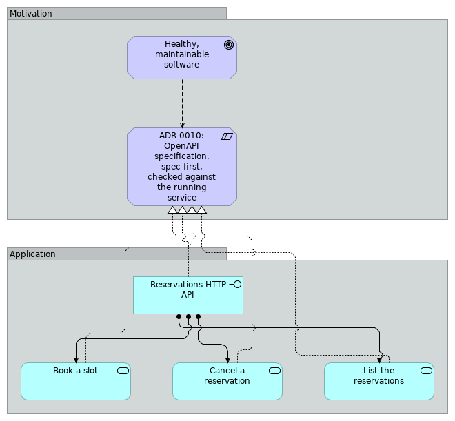

<!-- Generated from docs/architecture/model.xml (id-mot-adr-0010) by `just model-docs`. Do not edit: change the model, see docs/adr/template.md. -->
# 0010. OpenAPI specification, spec-first, checked against the running service

- Status: Accepted
- Date: 2026-11-16
- Issue: #60 (task #61)
- Deciders: human approver (approach chosen on 2026-11-16, change request #60), architect agent
- ArchiMate elements: `id-app-intf-reservation-api`, `id-app-svc-book`, `id-app-svc-cancel`,
  `id-app-svc-list`, `id-mot-goal-healthy`

## Elements this decision applies to

Clickable version:
[report](https://num-bbro.github.io/rust-factory/report/id-model-factory/views/id-view-adr-0010.html)

## Context and problem
The reservations HTTP API
([`id-app-intf-reservation-api`](../togaf/A-architecture-vision.md#id-app-intf-reservation-api)) is
described only as prose in the model and as Rust code in `crates/adapters-http`. Clients and other
tools have nothing machine-readable, and nothing checks that the prose matches what the service
answers. Change request #60 asks for an OpenAPI specification kept in the repo and checked in CI
against the running service. The human chose the approach on 2026-11-16; this ADR records it, with
the details that the tool spike of task #61 settled.

## Decision drivers
- One contract that people and tools can read, reviewed in the same PR as the behaviour it
  describes.
- The check must prove that the running service answers as the file says, not merely that the file
  matches annotations in the code.
- No new required check and no ruleset change: reuse the container that the acceptance tests already
  start (ADR 0005, [`id-mot-adr-0005`](0005-release-image-and-acceptance.md)).
- A standard tool, pinned exactly like the other tools; no home-made validator to maintain.
- No change to the service's behaviour, so no release.

## Options considered
1. **Spec-first, checked against the running service**: `docs/api/openapi.yaml` is written by hand
   and is the source of truth; Schemathesis sends generated requests to the running container and
   checks every response against it.
2. **Generated from code with `utoipa`**: annotations on the handlers produce the file, and CI
   compares it with the committed one. This proves only that the file equals the annotations;
   nothing checks that the handlers answer what the annotations claim (for example the framework's
   own rejections), and it adds a dependency and macros to `crates/adapters-http`.
3. **Both**: `utoipa` generates the file and Schemathesis checks the running service. The annotation
   work of option 2 for no assurance beyond option 1, and two descriptions of one contract to keep
   in step.
4. **A home-made validator in the acceptance tests**: the Gherkin steps load the spec and check each
   response they receive. It covers only the requests the scenarios send, and it is code to write
   and maintain instead of a standard tool.

## Decision
Chosen: **option 1**, because it is the only option whose check exercises the real service against
the published contract, it needs no change to the service code, and it runs inside a check that is
already required.

- **Source of truth:** `docs/api/openapi.yaml`, written and edited by hand. It is the contract of
  [`id-app-intf-reservation-api`](../togaf/A-architecture-vision.md#id-app-intf-reservation-api),
  whose documentation points to it; the model does not repeat it.
- **OpenAPI 3.1** (`openapi: 3.1.0`): the spike ran the pinned tool against a 3.1 file with no flag
  and no warning about the version, and 3.1 uses plain JSON Schema, so there is no reason to fall
  back to 3.0.3.
- **Contract version:** `info.version` is the version of the API contract, starting at `1.0.0`,
  independent of the release version in `Cargo.toml`. It changes when, and only when, the contract
  changes: major for a breaking change, minor for a compatible addition, patch for a correction of
  the text.
- **Framework rejections are documented as they are** (ADR 0007,
  [`id-mot-adr-0007`](0007-cancel-reservation-by-delete.md)): requests that axum rejects before a
  handler runs keep their plain-text bodies, and the spec lists them: `400` `text/plain` for an id
  that is not an unsigned integer and for malformed JSON, `415` `text/plain` for a request with a
  missing or wrong `Content-Type` (not `application/json`), and `422` `text/plain` for JSON of the
  wrong shape, next to the `422` `application/json` `{error}` of an invalid slot. Making the error
  bodies uniform would change the service's behaviour; if it is wanted, a new ADR decides it and the
  spec changes with it.
- **The check:** Schemathesis, pinned to an exact version in `mise.toml` (mise backend
  `pipx:schemathesis`), runs in a new recipe `just api-check <base-url>`, which `just acceptance`
  calls against the container it has already started. The required check `acceptance` therefore
  covers the contract, locally and in CI, with no ruleset change. Schemathesis checks status codes,
  content types, body schemas and that no request gets a 5xx answer, in all its phases, including
  the stateful one that follows the link from `POST /reservations` to `DELETE /reservations/{id}`.
- **Install:** `mise.toml` pins `uv` to an exact version as well, so the `pipx:schemathesis` backend
  installs through `uv tool install` identically on Arch, Ubuntu/WSL and CI, with no reliance on a
  system `pipx`. The tool runs on CPython 3.13, set with the backend's tool option `uvx_args =
  "--python 3.13"`; `uv` downloads that Python into `~/.local/share/uv/python` when the machine has
  no 3.13. The setup action (`.github/actions/setup`) therefore adds `~/.local/share/uv/python` to
  the paths it caches (key unchanged, it already covers `mise.toml`), because the tool's environment
  cached under `~/.local/share/mise` points at that interpreter; nothing else in the setup action
  changes.
- **Configuration:** `docs/api/schemathesis.toml`, passed explicitly by `just api-check` with the
  global option `--config-file` (`st --config-file docs/api/schemathesis.toml run …`), so the result
  does not depend on the working directory.
- **Reproducible runs:** `just api-check` runs with the fixed seed `1` and Schemathesis'
  deterministic generation mode, so every run sends the same generated requests and a red
  `acceptance` check can be rerun with the same inputs. The Gherkin scenarios run first against the
  same container, so the service state they leave behind, and with it some answers in the stateful
  phase, may still differ. Changing the seed is a deliberate change in a PR.
- **Rules that JSON Schema cannot express:** a schema-valid slot can still break a business rule
  (for example `start` not before `end`), which the service answers with `422` and `{error}`. The
  configuration therefore accepts, per operation, the rule answers that only the service can decide:
  `409` and `422` for `POST /reservations` (overlap, invalid slot) and `404` for `DELETE
  /reservations/{id}` (unknown id), each in its own `[[operations]]` entry; nothing else is relaxed,
  so for example a `404` to a schema-valid `POST` still fails.
- **Storage failures:** the spec documents `503` with `{error}` for both operations, because the
  code returns it on a storage failure, although the in-memory container never produces it.
  Schemathesis does not fail on a documented response that is never observed.
- **Not served:** the service does not serve the spec; no route and no code change.
- **Published:** the file lives under `docs/`, so the GitHub Pages site publishes it, and
  `docs/index.md` links it.

## Consequences
- Good: clients and tools get a machine-readable contract, and the required `acceptance` check fails
  when the service and the file disagree.
- Good: the undocumented corners of the API (the framework's rejections) are now written down; the
  spike's first run found every one of them.
- Good: no change to the service, its dependencies or its image.
- Bad: a PR that changes HTTP behaviour must change `docs/api/openapi.yaml` in the same PR, and its
  `info.version` when the contract changed; otherwise `acceptance` turns red or the version is
  stale, which the reviewer checks.
- Bad: one more tool, and the first written in Python, plus `uv` and a pinned CPython to run it.
- Bad: `just acceptance` takes a few seconds longer (about 4 s of tests in the spike).
- Consequence: `.github/workflows/release.yml` also runs `just acceptance`, so the contract check
  runs on the release image too, with the tool installed by the same setup step.
- Bad: a fixed seed explores the same cases on every run; new cases are tried only when the spec,
  the tool version or the seed changes.
- Follow-up: task #62 writes the spec, the Schemathesis configuration, `just api-check` and its call
  in `just acceptance`, the pins of `uv` and Schemathesis in `mise.toml`, the extra cached path in
  the setup action, the rule in `CLAUDE.md` and the link in `docs/index.md`.

## Option details
Spike of task #61 (2026-11-16): Schemathesis 4.33.4, the latest stable release, run with `uvx`
against the dev image started the way `just acceptance` starts it.
- **OpenAPI 3.1:** works with no flag.
- **First run**, with a draft that listed only the handlers' answers: 5 failures in 636 generated
  cases, all real gaps of the draft: `400` `text/plain` "Invalid URL: Cannot parse -1 to a u64"
  (`DELETE /reservations/-1`); `415` `text/plain` "Expected request with Content-Type:
  application/json" (`POST /reservations` with a missing or wrong `Content-Type`); `400`
  `text/plain` "Failed to parse the request body as JSON" (a malformed body); `422` `text/plain`
  "Failed to deserialize the JSON body into the target type" (for example `start` = `0.0`), a
  content type the draft did not list for `422`; and "schema-valid request rejected" for `start` =
  `end` = `0` (`422` with `{error}`).
- **Second run**, with those rejections documented and `404`, `409`, `422` accepted for schema-valid
  requests: no failures in about 790 cases, 3.3 to 3.7 s of test time, about 6 s in all with the
  tool already downloaded.
- **Determinism:** the same seed alone gave different numbers of cases on two runs (789 and 743);
  with `--generation-deterministic` added it gave 837 cases both times.
- **Install:** mise's `pipx:schemathesis` backend lists the exact versions and installed 4.33.4 in
  under a second with `uv tool install`; without `uv` on the PATH it falls back to `pipx`, which is
  why `uv` is pinned too. The tool option `uvx_args = "--python 3.13"` reached `uv` as `uv tool
  install schemathesis==4.33.4 --python 3.13`.
- **Per-operation configuration:** with two `[[operations]]` entries (`include-method`,
  `include-path`, `checks.positive_data_acceptance.expected-statuses`) passed by `--config-file`,
  the run passed (836 cases); leaving out `404` for `DELETE` made the check fail (ST202), so the
  scoping is applied.
