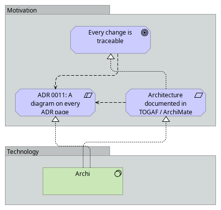

<!-- Generated from docs/architecture/model.xml (id-mot-adr-0011) by `just model-docs`. Do not edit: change the model, see docs/adr/template.md. -->
# 0011. A diagram on every ADR page

- Status: Accepted
- Date: 2026-11-17
- Issue: #69 (task #70)
- Deciders: human approver (approach chosen on 2026-11-17), architect agent
- ArchiMate elements: `id-mot-goal-traceable`, `id-mot-req-togaf`, `id-tech-sw-archi`

## Elements this decision applies to

Clickable version:
[report](https://num-bbro.github.io/rust-factory/report/id-model-factory/views/id-view-adr-0011.html)

## Context and problem
Since ADR 0009 ([`id-mot-adr-0009`](0009-archimate-exchange-model-as-source.md)) each TOGAF document
page shows its views as pictures, but an ADR page names the elements its decision applies to only as
a line of IDs ("ArchiMate elements"). A reader can go from a box in a diagram to the decisions about
it (the "Decisions" column of the catalogs), but not from a decision to its boxes in ArchiMate
notation. Change request #69 asks that every ADR page shows a diagram of the elements the decision
applies to, so that traceability
([`id-mot-goal-traceable`](../togaf/00-preliminary.md#id-mot-goal-traceable)) reads both ways.

## Decision drivers
- The diagram is ArchiMate, drawn by the pinned Archi
  ([`id-tech-sw-archi`](../togaf/C-information-systems-architecture.md#id-tech-sw-archi)) like every
  other view, so it looks the same as the document pages and other tools can read it.
- The model stays the single edited source (ADR 0009): no second place where diagrams are drawn.
- The diagram cannot drift from the links: what the picture shows and what the "ArchiMate elements"
  line lists must be the same elements, checked by `just model-check`.
- As little new home-made code as possible: reuse the view, image and page code paths that the
  documents already use.

## Options considered
1. **One ordinary view per ADR, written in the model**: a view with the ADR and its linked elements
   as members, laid out automatically by `just model-fmt` like every other view, named by a `View`
   property on the ADR.
2. **Views generated by the formatter from the links**: `just model-fmt` would create and update
   each ADR's view from its Realization and Influence relationships. The formatter would then write
   content, not only layout, and it is more home-made code to maintain.
3. **A diagram drawn outside the model** (for example Mermaid in the ADR text): not ArchiMate
   notation, and invisible to Archi and other tools that read the model.
4. **No diagram** (status quo): the ADR page keeps only the line of IDs.

## Decision
Chosen: **option 1**, the human's choice of 2026-11-17, because it reuses what the documents already
do (an ordinary view, an image rendered by Archi, a `View` property, the same page code), keeps the
formatter to layout only, and a check keeps the view and the links in step.

- **View:** each ADR `id-mot-adr-NNNN` has the view `id-view-adr-NNNN`, named "ADR NNNN: what the
  decision applies to", with automatic layout and no viewpoint (its members come from several
  layers), in `docs/architecture/model.xml` like every other view.
- **Members:** the ADR itself plus exactly the elements on its "ArchiMate elements" line, the
  sources of the Realization and Influence relationships to it. No Plateaus (the "Released in"
  line), and no other ADRs (the "Supersedes" and "Superseded by" lines). As in every view, the
  formatter draws all relationships between the members, not only those to the ADR.
- **Every ADR gets a view**, including superseded and deprecated ones and this ADR itself.
- **Link:** the ADR carries a `View` property naming its view, the same property the documents use.
- **Page:** directly after the header list, the ADR page has the heading "Elements this decision
  applies to", then the picture, then the line "Clickable version" linking the view's page in the
  report when the model has a `Site`. The generator shows them with the code path the document pages
  use. The page has no element table under the picture: the header list already names the elements.
- **Guard:** `just model-check` fails when an ADR has no view, or when its view's members differ
  from the ADR plus its linked elements.
- **New ADRs:** a new ADR adds its view and its `View` property in the same PR;
  `docs/adr/template.md` says so.

## Consequences
- Good: from an ADR page a reader sees, in ArchiMate notation, which motivation and core elements
  the decision constrains, and the "Clickable version" opens them in the report.
- Good: no new kind of file or tool; the views are ordinary model content that Archi and other tools
  read.
- Bad: one more committed PNG per ADR (11 now) and its `views.lock` entry; `just model` renders more
  views and takes longer.
- Bad: each new or relinked ADR must also add or update its view in the same PR; the check catches a
  forgotten one, but it is one more step.
- Bad: the layout is automatic, so a decision linked to many elements may give a crowded picture; it
  is accepted as drawn, because a view's members are fixed by the links.
- Follow-up: task #71 adds the views of all ADRs and their `View` properties, the page section in
  `gen_docs.py`, the guard in `check_model.py`, their tests and the rule in `docs/adr/template.md`.

## Option details
Sample of task #70 (2026-11-17): the view `id-view-adr-0007` of ADR 0007
([`id-mot-adr-0007`](0007-cancel-reservation-by-delete.md)), 8 members in three bands (Motivation,
Business, Application), rendered at 678 × 877 pixels; the ADR box shows its whole title in four
lines. Since task #73 the automatic layout makes a box grow in height to fit its whole name;
spreading the ends of the lines that meet on one edge of a box (here the four Realization arrows at
the bottom of the ADR box) is recorded as follow-up #75.
