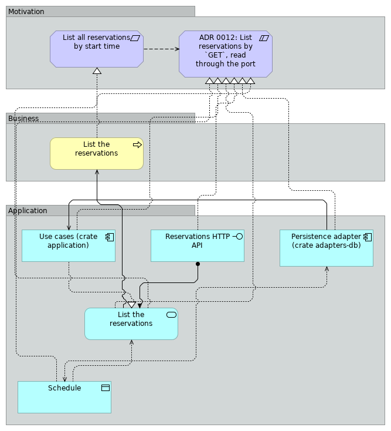

<!-- Generated from docs/architecture/model.xml (id-mot-adr-0012) by `just model-docs`. Do not edit: change the model, see docs/adr/template.md. -->
# 0012. List reservations by `GET`, read through the port

- Status: Proposed
- Date: 2026-11-17
- Issue: #80 (task #81)
- Deciders: human approver (plan approved at gate 1 on 2026-11-17), architect agent
- ArchiMate elements: `id-app-comp-application`, `id-app-comp-db`, `id-app-data-schedule`,
  `id-app-intf-reservation-api`, `id-app-svc-list`, `id-bus-proc-list`, `id-mot-req-list`
- Released in: v0.3.0

## Elements this decision applies to

Clickable version:
[report](https://num-bbro.github.io/rust-factory/report/id-model-factory/views/id-view-adr-0012.html)

## Context and problem
Epic #79: customers and the front desk cannot see which slots are already reserved, and a customer
who lost a reservation id cannot find it again to cancel. Story #80
([`id-mot-req-list`](../togaf/A-architecture-vision.md#id-mot-req-list)) asks for every reservation
made and not cancelled, with its id, start and end, ordered by start time; listing changes nothing.
Three things are not decided yet: the shape of the HTTP answer on the reservations API
([`id-app-intf-reservation-api`](../togaf/C-information-systems-architecture.md#id-app-intf-reservation-api)),
who guarantees the order, and how a use case reads the schedule at all, because the port
`ScheduleRepository` has only the atomic `update` of ADR 0008
([`id-mot-adr-0008`](0008-atomic-schedule-update-through-the-port.md)), which removed `load` on the
premise that nothing reads the schedule without writing it. Today `Schedule::reservations()` gives
the reservations in insertion order, with no guarantee. The human approved the plan at gate 1 on
2026-11-17; this ADR records it.

## Decision drivers
- Clients must not break when paging or filtering is added later (both out of scope of epic #79).
- The order is a business rule of story #80, so it belongs in the domain (ADR 0003), tested where
  the rule lives, not in an adapter or a handler.
- A list must not be able to change or store the schedule, by construction, and must see a
  consistent schedule, never half of a concurrent change.
- Consistent with the existing API: times are integer minutes since midnight and ids are integers,
  as in `POST /reservations`; the contract changes with the behaviour (ADR 0010,
  [`id-mot-adr-0010`](0010-openapi-specification-spec-first.md)).
- Smallest change; the service keeps one shared schedule and no notion of a customer (epic #79).

## Options considered
### Response shape
1. **(A1) An object holding the list**: `{"reservations": [{"id": 1, "start": 540, "end": 600}]}`.
2. **(A2) A bare JSON array**: `[{"id": 1, "start": 540, "end": 600}]`; adding paging later (a
   cursor, a total) would change the top-level type and break every client.

### Order
1. **(B1) By start time, guaranteed by the domain**: `Schedule` promises the order, and the use case
   and adapters pass it through.
2. **(B2) By id**: follows booking order, which says nothing about the day; a client that wants the
   day in order sorts itself.
3. **(B3) Unspecified**: today's insertion order, which clients would come to rely on anyway, and
   which story #80 rules out.

### Read access
1. **(C1) A read-only operation on the port beside `update`**: it can only read the current
   schedule, and it stores nothing.
2. **(C2) Listing through `update` with a change that changes nothing**: no port change, but every
   list takes the write path, clones the schedule and stores it back, and the type no longer tells
   readers from writers.
3. **(C3) Bring back `load`, returning a copy of the schedule** (added at drafting, see Notes):
   simple to call, but it reopens the load–change–save pattern that caused bug #26 and that ADR 0008
   removed on purpose.

### Empty schedule
1. **(D1) `200` with an empty list.**
2. **(D2) `404 Not Found`** (added at drafting, see Notes): the collection exists even when it is
   empty, and a client would have to treat an error as a normal answer.

## Decision
Chosen: **A1, B1, C1 and D1**, because the object leaves room for paging without a breaking change,
the order is a business rule and is kept where the other rules are, a read-only operation makes
"listing changes nothing" a property of the types rather than of each caller's discipline, and an
empty schedule is a normal state.

- **Route:** `GET /reservations` on
  [`id-app-intf-reservation-api`](../togaf/C-information-systems-architecture.md#id-app-intf-reservation-api),
  realised by a new use case `ListReservations` in `crates/application`
  ([`id-app-svc-list`](../togaf/A-architecture-vision.md#id-app-svc-list)). Answer `200 OK`,
  `application/json`, body `{"reservations": [{"id": 1, "start": 540, "end": 600}]}`: `id` as the
  `POST /reservations` answer gives it, `start` and `end` in minutes since midnight as in the
  booking request. Every reservation made and not cancelled appears exactly once; the object has no
  other field yet.
- **Order:** ascending `start`. Reservations never overlap (the booking rule), so no two share a
  start and the order needs no tie-break. The domain guarantees it: `Schedule::reservations()`
  ([`id-app-data-schedule`](../togaf/C-information-systems-architecture.md#id-app-data-schedule),
  crate `domain`) is documented and tested to yield reservations by start time, whatever the booking
  order; the use case and adapters neither sort nor reorder. Whether the domain keeps its list
  sorted or sorts when asked is left to the implementing task.
- **Read access:** the port `ScheduleRepository`
  ([`id-app-comp-application`](../togaf/C-information-systems-architecture.md#id-app-comp-application))
  gains one read-only operation beside `update`. It runs under the same lock as `update` (in the
  in-memory adapter,
  [`id-app-comp-db`](../togaf/C-information-systems-architecture.md#id-app-comp-db)), so a read sees
  the schedule as it is between two changes; it cannot change the schedule, and it stores nothing.
  Its name, signature and error style are left to task #82, which follows the style of `update` (ADR 0008)
  unless it states a reason not to.
- **Errors:** a storage failure answers `503 Service Unavailable` with `{error}`, as the other
  routes do (ADR 0007, ADR 0010); added at drafting, see Notes.
- **Empty schedule:** `200` with `{"reservations": []}`. It is checked by a unit test, not by an
  acceptance scenario, because the acceptance tests share one running container (story #80).
- **Contract:** `docs/api/openapi.yaml` gains `get` on `/reservations`, and `info.version` goes from
  `1.0.0` to `1.1.0`, a compatible addition (ADR 0010), in the PR that adds the route, not before.
- **ADR 0008 stays in force:** every change still goes through `update`. This ADR revises only the
  premise of its decision that nothing reads the schedule without writing it: reads now exist, and
  they get their own operation, which cannot store, rather than a `load` that could be paired with a
  `save` again.
- **Out of scope**, as epic #79 sets it (not decided here): customer identity, filtering, paging and
  search, and the history of cancelled reservations.

## Consequences
- Good: a customer can see which slots are taken and find a lost reservation id again, which is the
  success measure of epic #79.
- Good: clients can rely on the order, which is tested in the domain, next to the overlap rule that
  makes it total.
- Good: paging or filtering can later add fields beside `reservations` without breaking clients.
- Good: a list cannot change or store the schedule.
- Bad: the port gets a second operation that every adapter and every test double must implement.
- Bad: every caller sees every reservation and its id, and anyone who knows an id can cancel it (ADR
  0007, [`id-mot-adr-0007`](0007-cancel-reservation-by-delete.md)): the list makes those ids easy to
  find. Accepted for the sample domain, which has no customer identity; a later epic with customer
  identity must revisit both decisions.
- Bad: the whole list comes in one answer. Fine for one day's reservations; paging needs a new ADR
  if the schedule grows.
- Bad: in the in-memory adapter a read holds the same lock as the changes, so a list briefly waits
  for, and delays, bookings and cancellations on that host.
- Follow-up: task #82 adds the order guarantee in `crates/domain`, the read operation (its name and
  signature) and `ListReservations` in `crates/application`, and the operation in
  `crates/adapters-db`; task #83 adds the route, the contract `1.1.0` and the acceptance scenarios
  of story #80.

## Notes
- Added at drafting: three points go beyond the plan approved at gate 1 on 2026-11-17 and were added
  by the architect agent: the `503` rule for a storage failure, and the rejected options C3 (bring
  back `load`) and D2 (`404` for an empty schedule). The human's sign-off of PR #84 confirms them.
