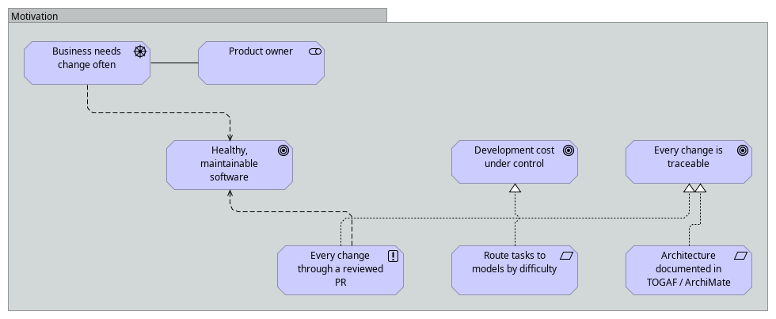

<!-- Generated from docs/architecture/model.xml (id-impl-del-preliminary) by `just model-docs`. Do not edit: change the model, see docs/togaf/template.md. -->
# Preliminary

**Purpose:** Set up how architecture work is done: principles, governance, tools.

## Outputs
- Architecture principles (see Motivation view: [`id-mot-pr-pr-only`](#id-mot-pr-pr-only))
- Who approves what (human gates in `CLAUDE.md`)
- Tools and repositories (`bootstrap.sh`, GitHub, Archi)

## Content
Principles for this factory:

1. **Every change through a reviewed PR** ([`id-mot-pr-pr-only`](#id-mot-pr-pr-only)): `main` is
   protected.
2. **Architecture as code**: the ArchiMate model and these documents live in git and change through
   PRs.
3. **Decisions are recorded**: every significant decision gets an ADR in `docs/adr/`.
4. **Right model for the job**: work is routed to AI models by difficulty
   ([`id-mot-req-routing`](#id-mot-req-routing)).
5. **Business logic stays pure**: domain code has no IO, so business rules can change safely.

## Open questions
- _none yet_

## Why the factory exists

Stakeholder, drivers, goals, principles and requirements behind the factory.

| ID | Name | Type | Decisions | Issues | Crate / code | Release | Other documents |
|---|---|---|---|---|---|---|---|
| `id-mot-drv-change` | Business needs change often | Driver |  |  |  |  | [A. Architecture Vision](A-architecture-vision.md#id-mot-drv-change) |
| `id-mot-goal-cost` | Development cost under control | Goal | [ADR 0004](../adr/0004-agent-team-and-cost-routing.md) |  |  |  | [A. Architecture Vision](A-architecture-vision.md#id-mot-goal-cost) |
| `id-mot-goal-healthy` | Healthy, maintainable software | Goal | [ADR 0003](../adr/0003-layered-cargo-workspace.md) |  |  |  | [A. Architecture Vision](A-architecture-vision.md#id-mot-goal-healthy) |
| `id-mot-goal-traceable` | Every change is traceable | Goal | [ADR 0001](../adr/0001-record-architecture-decisions.md) |  |  |  | [A. Architecture Vision](A-architecture-vision.md#id-mot-goal-traceable) |
| `id-mot-pr-pr-only` | Every change through a reviewed PR | Principle |  |  |  |  | [A. Architecture Vision](A-architecture-vision.md#id-mot-pr-pr-only) |
| `id-mot-req-routing` | Route tasks to models by difficulty | Requirement | [ADR 0004](../adr/0004-agent-team-and-cost-routing.md) |  |  |  | [A. Architecture Vision](A-architecture-vision.md#id-mot-req-routing), [C. Information Systems Architecture](C-information-systems-architecture.md#id-mot-req-routing), [D. Technology Architecture](D-technology-architecture.md#id-mot-req-routing) |
| `id-mot-req-togaf` | Architecture documented in TOGAF / ArchiMate | Requirement | [ADR 0002](../adr/0002-archimate-model-as-text.md), [ADR 0009](../adr/0009-archimate-exchange-model-as-source.md) |  |  |  | [A. Architecture Vision](A-architecture-vision.md#id-mot-req-togaf), [C. Information Systems Architecture](C-information-systems-architecture.md#id-mot-req-togaf), [D. Technology Architecture](D-technology-architecture.md#id-mot-req-togaf) |
| `id-mot-sh-product-owner` | Product owner | Stakeholder |  |  |  |  | [A. Architecture Vision](A-architecture-vision.md#id-mot-sh-product-owner) |
