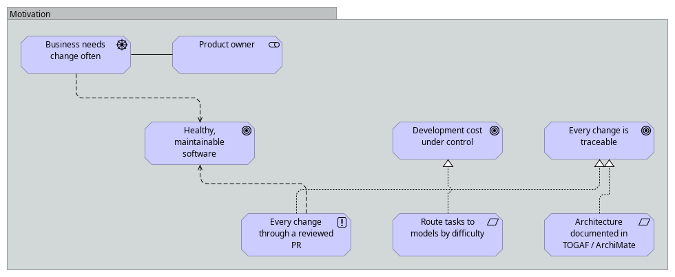
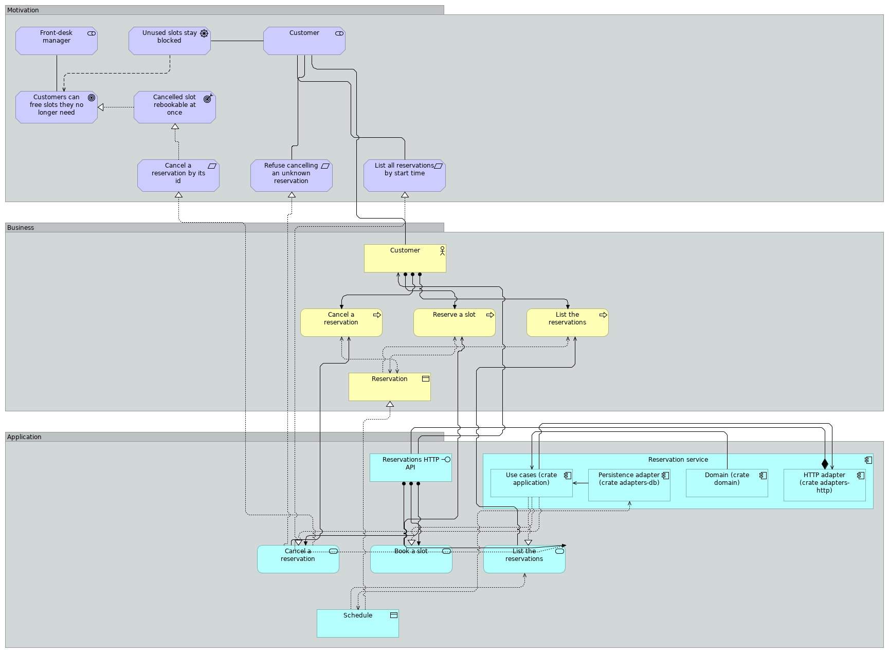

<!-- Generated from docs/architecture/model.xml (id-impl-del-architecture-vision) by `just model-docs`. Do not edit: change the model, see docs/togaf/template.md. -->
# A. Architecture Vision

**Purpose:** Agree the business goal, scope, stakeholders and success measures before design starts.

## Outputs
- Stakeholders and concerns
- Drivers and goals
- Scope (in / out)
- Success measures

## Content
Vision for the factory: a business need becomes healthy, rolled-out Rust software, with every change
traceable and AI cost under control.

- Stakeholder: product owner ([`id-mot-sh-product-owner`](#id-mot-sh-product-owner))
- Driver: business needs change often ([`id-mot-drv-change`](#id-mot-drv-change))
- Goals: healthy software ([`id-mot-goal-healthy`](#id-mot-goal-healthy)), traceability
  ([`id-mot-goal-traceable`](#id-mot-goal-traceable)), cost control
  ([`id-mot-goal-cost`](#id-mot-goal-cost))

For a project, the vision is captured first as an **Epic** issue, then reflected here and in the
Motivation view.

### Sample domain: reservations (epic #17)
The factory's sample product is a reservation service for time slots. Epic #17, "Customers can
cancel a reservation", is its first change after booking:

- Stakeholders: customers ([`id-mot-sh-customer`](#id-mot-sh-customer)), who use it, and the
  front-desk manager ([`id-mot-sh-front-desk`](#id-mot-sh-front-desk)), who decides.
- Driver: unused slots stay blocked ([`id-mot-drv-blocked-slots`](#id-mot-drv-blocked-slots)).
- Goal: customers can free slots they no longer need
  ([`id-mot-goal-free-slots`](#id-mot-goal-free-slots)), measured by the outcome "a cancelled slot
  can be booked again immediately" ([`id-mot-out-rebook`](#id-mot-out-rebook)).
- Out of scope: refunds, notifications, cancellation deadlines.

Epic #79, "Customers can list the reservations", follows: customers and the front desk cannot see
which slots are taken, and a customer who lost a reservation id cannot find it again to cancel. Same
stakeholders; success measure: every reservation made and not cancelled can be read back through the
API, with its id and time slot (story #80, [`id-mot-req-list`](#id-mot-req-list)). Out of scope:
customer identity, filtering, paging, search and the history of cancelled reservations; the service
keeps one shared schedule.

## Open questions
- _none yet_

## Why the factory exists

Stakeholder, drivers, goals, principles and requirements behind the factory.

Clickable version:
[report](https://num-bbro.github.io/rust-factory/report/id-model-factory/views/id-view-motivation.html)

| ID | Name | Type | Decisions | Issues | Crate / code | Release | Other documents |
|---|---|---|---|---|---|---|---|
| `id-mot-drv-change` | Business needs change often | Driver |  |  |  |  | [Preliminary](00-preliminary.md#id-mot-drv-change) |
| `id-mot-goal-cost` | Development cost under control | Goal | [ADR 0004](../adr/0004-agent-team-and-cost-routing.md) |  |  |  | [Preliminary](00-preliminary.md#id-mot-goal-cost) |
| `id-mot-goal-healthy` | Healthy, maintainable software | Goal | [ADR 0003](../adr/0003-layered-cargo-workspace.md), [ADR 0010](../adr/0010-openapi-specification-spec-first.md) |  |  |  | [Preliminary](00-preliminary.md#id-mot-goal-healthy) |
| `id-mot-goal-traceable` | Every change is traceable | Goal | [ADR 0001](../adr/0001-record-architecture-decisions.md), [ADR 0011](../adr/0011-a-diagram-on-every-adr-page.md) |  |  |  | [Preliminary](00-preliminary.md#id-mot-goal-traceable) |
| `id-mot-pr-pr-only` | Every change through a reviewed PR | Principle |  |  |  |  | [Preliminary](00-preliminary.md#id-mot-pr-pr-only) |
| `id-mot-req-routing` | Route tasks to models by difficulty | Requirement | [ADR 0004](../adr/0004-agent-team-and-cost-routing.md) |  |  |  | [Preliminary](00-preliminary.md#id-mot-req-routing), [C. Information Systems Architecture](C-information-systems-architecture.md#id-mot-req-routing), [D. Technology Architecture](D-technology-architecture.md#id-mot-req-routing) |
| `id-mot-req-togaf` | Architecture documented in TOGAF / ArchiMate | Requirement | [ADR 0002](../adr/0002-archimate-model-as-text.md), [ADR 0009](../adr/0009-archimate-exchange-model-as-source.md), [ADR 0011](../adr/0011-a-diagram-on-every-adr-page.md) |  |  |  | [Preliminary](00-preliminary.md#id-mot-req-togaf), [C. Information Systems Architecture](C-information-systems-architecture.md#id-mot-req-togaf), [D. Technology Architecture](D-technology-architecture.md#id-mot-req-togaf) |
| `id-mot-sh-product-owner` | Product owner | Stakeholder |  |  |  |  | [Preliminary](00-preliminary.md#id-mot-sh-product-owner) |

## Reservations: book, cancel and list

Sample reservation domain, epics #17 and #79: why customers cancel and list, the business processes,
and the crates and API that serve them. Technology is unchanged (see id-view-layered).

Clickable version:
[report](https://num-bbro.github.io/rust-factory/report/id-model-factory/views/id-view-reservation-cancel.html)

| ID | Name | Type | Decisions | Issues | Crate / code | Release | Other documents |
|---|---|---|---|---|---|---|---|
| `id-app-comp-application` | Use cases (crate application) | ApplicationComponent | [ADR 0008](../adr/0008-atomic-schedule-update-through-the-port.md), [ADR 0012](../adr/0012-list-reservations-by-get.md) |  | `crates/application` | Release v0.1.0, Release v0.2.0, Release v0.2.1 | [B. Business Architecture](B-business-architecture.md#id-app-comp-application), [C. Information Systems Architecture](C-information-systems-architecture.md#id-app-comp-application), [Requirements Management](requirements-management.md#id-app-comp-application) |
| `id-app-comp-db` | Persistence adapter (crate adapters-db) | ApplicationComponent | [ADR 0008](../adr/0008-atomic-schedule-update-through-the-port.md), [ADR 0012](../adr/0012-list-reservations-by-get.md) |  | `crates/adapters-db` | Release v0.1.0, Release v0.2.1 | [B. Business Architecture](B-business-architecture.md#id-app-comp-db), [C. Information Systems Architecture](C-information-systems-architecture.md#id-app-comp-db), [Requirements Management](requirements-management.md#id-app-comp-db) |
| `id-app-comp-domain` | Domain (crate domain) | ApplicationComponent |  |  | `crates/domain` | Release v0.1.0 | [B. Business Architecture](B-business-architecture.md#id-app-comp-domain), [C. Information Systems Architecture](C-information-systems-architecture.md#id-app-comp-domain), [Requirements Management](requirements-management.md#id-app-comp-domain) |
| `id-app-comp-http` | HTTP adapter (crate adapters-http) | ApplicationComponent |  |  | `crates/adapters-http` | Release v0.1.0, Release v0.2.0, Release v0.2.1 | [B. Business Architecture](B-business-architecture.md#id-app-comp-http), [C. Information Systems Architecture](C-information-systems-architecture.md#id-app-comp-http), [Requirements Management](requirements-management.md#id-app-comp-http) |
| `id-app-comp-reservation-svc` | Reservation service | ApplicationComponent | [ADR 0003](../adr/0003-layered-cargo-workspace.md) |  | `crates/app` | Release v0.1.0 | [B. Business Architecture](B-business-architecture.md#id-app-comp-reservation-svc), [C. Information Systems Architecture](C-information-systems-architecture.md#id-app-comp-reservation-svc), [Requirements Management](requirements-management.md#id-app-comp-reservation-svc) |
| `id-app-data-schedule` | Schedule | DataObject | [ADR 0007](../adr/0007-cancel-reservation-by-delete.md), [ADR 0008](../adr/0008-atomic-schedule-update-through-the-port.md), [ADR 0012](../adr/0012-list-reservations-by-get.md) | #26 | `crates/domain`, `Schedule` | Release v0.1.0, Release v0.2.1 | [B. Business Architecture](B-business-architecture.md#id-app-data-schedule), [C. Information Systems Architecture](C-information-systems-architecture.md#id-app-data-schedule), [Requirements Management](requirements-management.md#id-app-data-schedule) |
| `id-app-intf-reservation-api` | Reservations HTTP API | ApplicationInterface | [ADR 0007](../adr/0007-cancel-reservation-by-delete.md), [ADR 0010](../adr/0010-openapi-specification-spec-first.md), [ADR 0012](../adr/0012-list-reservations-by-get.md) |  |  | Release v0.1.0, Release v0.2.0 | [B. Business Architecture](B-business-architecture.md#id-app-intf-reservation-api), [C. Information Systems Architecture](C-information-systems-architecture.md#id-app-intf-reservation-api), [Requirements Management](requirements-management.md#id-app-intf-reservation-api) |
| `id-app-svc-book` | Book a slot | ApplicationService | [ADR 0010](../adr/0010-openapi-specification-spec-first.md) |  | `crates/application`, `BookSlot` | Release v0.1.0 | [B. Business Architecture](B-business-architecture.md#id-app-svc-book), [C. Information Systems Architecture](C-information-systems-architecture.md#id-app-svc-book), [Requirements Management](requirements-management.md#id-app-svc-book) |
| `id-app-svc-cancel` | Cancel a reservation | ApplicationService | [ADR 0007](../adr/0007-cancel-reservation-by-delete.md), [ADR 0010](../adr/0010-openapi-specification-spec-first.md) | #17 |  | Release v0.2.0 | [B. Business Architecture](B-business-architecture.md#id-app-svc-cancel), [C. Information Systems Architecture](C-information-systems-architecture.md#id-app-svc-cancel), [Requirements Management](requirements-management.md#id-app-svc-cancel) |
| `id-app-svc-list` | List the reservations | ApplicationService | [ADR 0010](../adr/0010-openapi-specification-spec-first.md), [ADR 0012](../adr/0012-list-reservations-by-get.md) | #79 | `crates/application`, `ListReservations` |  | [B. Business Architecture](B-business-architecture.md#id-app-svc-list), [C. Information Systems Architecture](C-information-systems-architecture.md#id-app-svc-list), [Requirements Management](requirements-management.md#id-app-svc-list) |
| `id-bus-act-customer` | Customer | BusinessActor |  |  |  |  | [B. Business Architecture](B-business-architecture.md#id-bus-act-customer), [C. Information Systems Architecture](C-information-systems-architecture.md#id-bus-act-customer), [Requirements Management](requirements-management.md#id-bus-act-customer) |
| `id-bus-obj-reservation` | Reservation | BusinessObject |  |  |  | Release v0.1.0 | [B. Business Architecture](B-business-architecture.md#id-bus-obj-reservation), [C. Information Systems Architecture](C-information-systems-architecture.md#id-bus-obj-reservation), [Requirements Management](requirements-management.md#id-bus-obj-reservation) |
| `id-bus-proc-cancel` | Cancel a reservation | BusinessProcess | [ADR 0007](../adr/0007-cancel-reservation-by-delete.md) | #17 |  | Release v0.2.0 | [B. Business Architecture](B-business-architecture.md#id-bus-proc-cancel), [C. Information Systems Architecture](C-information-systems-architecture.md#id-bus-proc-cancel), [Requirements Management](requirements-management.md#id-bus-proc-cancel) |
| `id-bus-proc-list` | List the reservations | BusinessProcess | [ADR 0012](../adr/0012-list-reservations-by-get.md) | #79 |  |  | [B. Business Architecture](B-business-architecture.md#id-bus-proc-list), [C. Information Systems Architecture](C-information-systems-architecture.md#id-bus-proc-list), [Requirements Management](requirements-management.md#id-bus-proc-list) |
| `id-bus-proc-reserve` | Reserve a slot | BusinessProcess |  |  |  | Release v0.1.0 | [B. Business Architecture](B-business-architecture.md#id-bus-proc-reserve), [C. Information Systems Architecture](C-information-systems-architecture.md#id-bus-proc-reserve), [Requirements Management](requirements-management.md#id-bus-proc-reserve) |
| `id-mot-drv-blocked-slots` | Unused slots stay blocked | Driver |  | #17 |  |  | [B. Business Architecture](B-business-architecture.md#id-mot-drv-blocked-slots), [C. Information Systems Architecture](C-information-systems-architecture.md#id-mot-drv-blocked-slots), [Requirements Management](requirements-management.md#id-mot-drv-blocked-slots) |
| `id-mot-goal-free-slots` | Customers can free slots they no longer need | Goal |  |  |  | Release v0.2.0 | [B. Business Architecture](B-business-architecture.md#id-mot-goal-free-slots), [C. Information Systems Architecture](C-information-systems-architecture.md#id-mot-goal-free-slots), [Requirements Management](requirements-management.md#id-mot-goal-free-slots) |
| `id-mot-out-rebook` | Cancelled slot rebookable at once | Outcome | [ADR 0007](../adr/0007-cancel-reservation-by-delete.md) | #17 |  | Release v0.2.0 | [B. Business Architecture](B-business-architecture.md#id-mot-out-rebook), [C. Information Systems Architecture](C-information-systems-architecture.md#id-mot-out-rebook), [Requirements Management](requirements-management.md#id-mot-out-rebook) |
| `id-mot-req-cancel` | Cancel a reservation by its id | Requirement | [ADR 0007](../adr/0007-cancel-reservation-by-delete.md) | #18 |  | Release v0.2.0 | [B. Business Architecture](B-business-architecture.md#id-mot-req-cancel), [C. Information Systems Architecture](C-information-systems-architecture.md#id-mot-req-cancel), [Requirements Management](requirements-management.md#id-mot-req-cancel) |
| `id-mot-req-cancel-refused` | Refuse cancelling an unknown reservation | Requirement | [ADR 0007](../adr/0007-cancel-reservation-by-delete.md) | #19 |  | Release v0.2.0 | [B. Business Architecture](B-business-architecture.md#id-mot-req-cancel-refused), [C. Information Systems Architecture](C-information-systems-architecture.md#id-mot-req-cancel-refused), [Requirements Management](requirements-management.md#id-mot-req-cancel-refused) |
| `id-mot-req-list` | List all reservations by start time | Requirement | [ADR 0012](../adr/0012-list-reservations-by-get.md) | #80 |  |  | [B. Business Architecture](B-business-architecture.md#id-mot-req-list), [C. Information Systems Architecture](C-information-systems-architecture.md#id-mot-req-list), [Requirements Management](requirements-management.md#id-mot-req-list) |
| `id-mot-sh-customer` | Customer | Stakeholder |  |  |  |  | [B. Business Architecture](B-business-architecture.md#id-mot-sh-customer), [C. Information Systems Architecture](C-information-systems-architecture.md#id-mot-sh-customer), [Requirements Management](requirements-management.md#id-mot-sh-customer) |
| `id-mot-sh-front-desk` | Front-desk manager | Stakeholder |  |  |  |  | [B. Business Architecture](B-business-architecture.md#id-mot-sh-front-desk), [C. Information Systems Architecture](C-information-systems-architecture.md#id-mot-sh-front-desk), [Requirements Management](requirements-management.md#id-mot-sh-front-desk) |
