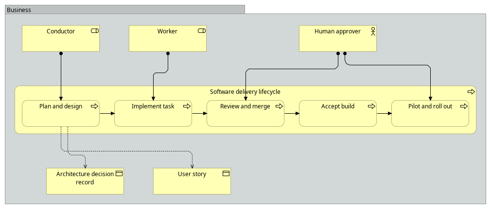
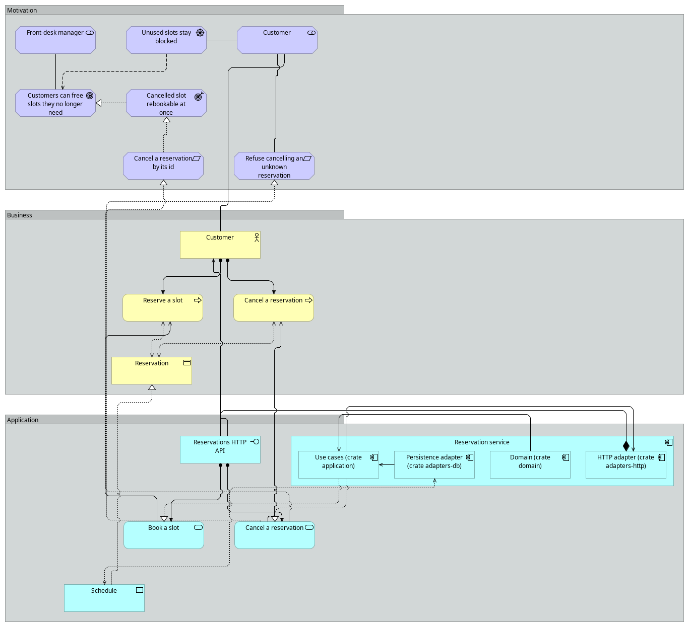

<!-- Generated from docs/architecture/model.xml (id-impl-del-business-architecture) by `just model-docs`. Do not edit: change the model, see docs/togaf/template.md. -->
# B. Business Architecture

**Purpose:** Describe how the business works: actors, roles, processes, information they use.

## Outputs
- Actors and roles
- Business processes
- Business objects
- Gaps between current and target

## Content
The factory's delivery lifecycle ([`id-bus-proc-lifecycle`](#id-bus-proc-lifecycle)) consists of
plan and design, implement task, review and merge, accept build, and pilot and roll out. The human
approver ([`id-bus-act-human`](#id-bus-act-human)) holds the review and deploy gates; the conductor
and worker roles are filled by AI agents.

For a project, each **user story** maps to business behaviour here; business rules become
domain-layer code.

### Sample domain: reservations
A customer ([`id-bus-act-customer`](#id-bus-act-customer)) reserves a slot
([`id-bus-proc-reserve`](#id-bus-proc-reserve)) and, since epic #17, can cancel it again
([`id-bus-proc-cancel`](#id-bus-proc-cancel)); both work on a reservation
([`id-bus-obj-reservation`](#id-bus-obj-reservation)). Business rules for cancelling (stories #18,
#19): only the named reservation is removed, its slot is free at once, no history is kept, and
cancelling a reservation that does not exist (or no longer exists) is refused and changes nothing.
Decision and alternatives: ADR 0007.

## Open questions
- _none yet_

## Delivery lifecycle

Who does what in the delivery lifecycle.

Clickable version:
[report](https://num-bbro.github.io/rust-factory/report/id-model-factory/views/id-view-lifecycle.html)

| ID | Name | Type | Decisions | Issues | Crate / code | Release | Other documents |
|---|---|---|---|---|---|---|---|
| `id-bus-act-human` | Human approver | BusinessActor |  |  |  |  | [C. Information Systems Architecture](C-information-systems-architecture.md#id-bus-act-human), [D. Technology Architecture](D-technology-architecture.md#id-bus-act-human), [G. Implementation Governance](G-implementation-governance.md#id-bus-act-human) |
| `id-bus-obj-adr` | Architecture decision record | BusinessObject | [ADR 0001](../adr/0001-record-architecture-decisions.md) |  |  |  | [G. Implementation Governance](G-implementation-governance.md#id-bus-obj-adr) |
| `id-bus-obj-story` | User story | BusinessObject |  |  |  |  | [G. Implementation Governance](G-implementation-governance.md#id-bus-obj-story) |
| `id-bus-proc-accept` | Accept build | BusinessProcess | [ADR 0005](../adr/0005-release-image-and-acceptance.md) |  |  |  | [G. Implementation Governance](G-implementation-governance.md#id-bus-proc-accept) |
| `id-bus-proc-deploy` | Pilot and roll out | BusinessProcess | [ADR 0006](../adr/0006-pilot-and-rollout-with-quadlet.md) |  |  |  | [C. Information Systems Architecture](C-information-systems-architecture.md#id-bus-proc-deploy), [D. Technology Architecture](D-technology-architecture.md#id-bus-proc-deploy), [G. Implementation Governance](G-implementation-governance.md#id-bus-proc-deploy) |
| `id-bus-proc-implement` | Implement task | BusinessProcess |  |  |  |  | [C. Information Systems Architecture](C-information-systems-architecture.md#id-bus-proc-implement), [D. Technology Architecture](D-technology-architecture.md#id-bus-proc-implement), [G. Implementation Governance](G-implementation-governance.md#id-bus-proc-implement) |
| `id-bus-proc-lifecycle` | Software delivery lifecycle | BusinessProcess |  |  |  |  | [G. Implementation Governance](G-implementation-governance.md#id-bus-proc-lifecycle) |
| `id-bus-proc-plan` | Plan and design | BusinessProcess |  |  |  |  | [C. Information Systems Architecture](C-information-systems-architecture.md#id-bus-proc-plan), [D. Technology Architecture](D-technology-architecture.md#id-bus-proc-plan), [G. Implementation Governance](G-implementation-governance.md#id-bus-proc-plan) |
| `id-bus-proc-review` | Review and merge | BusinessProcess |  |  |  |  | [C. Information Systems Architecture](C-information-systems-architecture.md#id-bus-proc-review), [D. Technology Architecture](D-technology-architecture.md#id-bus-proc-review), [G. Implementation Governance](G-implementation-governance.md#id-bus-proc-review) |
| `id-bus-role-conductor` | Conductor | BusinessRole |  |  |  |  | [C. Information Systems Architecture](C-information-systems-architecture.md#id-bus-role-conductor), [D. Technology Architecture](D-technology-architecture.md#id-bus-role-conductor), [G. Implementation Governance](G-implementation-governance.md#id-bus-role-conductor) |
| `id-bus-role-worker` | Worker | BusinessRole |  |  |  |  | [C. Information Systems Architecture](C-information-systems-architecture.md#id-bus-role-worker), [D. Technology Architecture](D-technology-architecture.md#id-bus-role-worker), [G. Implementation Governance](G-implementation-governance.md#id-bus-role-worker) |

## Reservations: cancel a reservation

Sample reservation domain, epic #17: why customers cancel, the business processes, and the crates
and API that serve them. Technology is unchanged (see id-view-layered).

Clickable version:
[report](https://num-bbro.github.io/rust-factory/report/id-model-factory/views/id-view-reservation-cancel.html)

| ID | Name | Type | Decisions | Issues | Crate / code | Release | Other documents |
|---|---|---|---|---|---|---|---|
| `id-app-comp-application` | Use cases (crate application) | ApplicationComponent | [ADR 0008](../adr/0008-atomic-schedule-update-through-the-port.md) |  | `crates/application` | Release v0.1.0, Release v0.2.0, Release v0.2.1 | [A. Architecture Vision](A-architecture-vision.md#id-app-comp-application), [C. Information Systems Architecture](C-information-systems-architecture.md#id-app-comp-application), [Requirements Management](requirements-management.md#id-app-comp-application) |
| `id-app-comp-db` | Persistence adapter (crate adapters-db) | ApplicationComponent | [ADR 0008](../adr/0008-atomic-schedule-update-through-the-port.md) |  | `crates/adapters-db` | Release v0.1.0, Release v0.2.1 | [A. Architecture Vision](A-architecture-vision.md#id-app-comp-db), [C. Information Systems Architecture](C-information-systems-architecture.md#id-app-comp-db), [Requirements Management](requirements-management.md#id-app-comp-db) |
| `id-app-comp-domain` | Domain (crate domain) | ApplicationComponent |  |  | `crates/domain` | Release v0.1.0 | [A. Architecture Vision](A-architecture-vision.md#id-app-comp-domain), [C. Information Systems Architecture](C-information-systems-architecture.md#id-app-comp-domain), [Requirements Management](requirements-management.md#id-app-comp-domain) |
| `id-app-comp-http` | HTTP adapter (crate adapters-http) | ApplicationComponent |  |  | `crates/adapters-http` | Release v0.1.0, Release v0.2.0, Release v0.2.1 | [A. Architecture Vision](A-architecture-vision.md#id-app-comp-http), [C. Information Systems Architecture](C-information-systems-architecture.md#id-app-comp-http), [Requirements Management](requirements-management.md#id-app-comp-http) |
| `id-app-comp-reservation-svc` | Reservation service | ApplicationComponent | [ADR 0003](../adr/0003-layered-cargo-workspace.md) |  | `crates/app` | Release v0.1.0 | [A. Architecture Vision](A-architecture-vision.md#id-app-comp-reservation-svc), [C. Information Systems Architecture](C-information-systems-architecture.md#id-app-comp-reservation-svc), [Requirements Management](requirements-management.md#id-app-comp-reservation-svc) |
| `id-app-data-schedule` | Schedule | DataObject | [ADR 0007](../adr/0007-cancel-reservation-by-delete.md), [ADR 0008](../adr/0008-atomic-schedule-update-through-the-port.md) | #26 | `crates/domain`, `Schedule` | Release v0.1.0, Release v0.2.1 | [A. Architecture Vision](A-architecture-vision.md#id-app-data-schedule), [C. Information Systems Architecture](C-information-systems-architecture.md#id-app-data-schedule), [Requirements Management](requirements-management.md#id-app-data-schedule) |
| `id-app-intf-reservation-api` | Reservations HTTP API | ApplicationInterface | [ADR 0007](../adr/0007-cancel-reservation-by-delete.md), [ADR 0010](../adr/0010-openapi-specification-spec-first.md) |  |  | Release v0.1.0, Release v0.2.0 | [A. Architecture Vision](A-architecture-vision.md#id-app-intf-reservation-api), [C. Information Systems Architecture](C-information-systems-architecture.md#id-app-intf-reservation-api), [Requirements Management](requirements-management.md#id-app-intf-reservation-api) |
| `id-app-svc-book` | Book a slot | ApplicationService | [ADR 0010](../adr/0010-openapi-specification-spec-first.md) |  | `crates/application`, `BookSlot` | Release v0.1.0 | [A. Architecture Vision](A-architecture-vision.md#id-app-svc-book), [C. Information Systems Architecture](C-information-systems-architecture.md#id-app-svc-book), [Requirements Management](requirements-management.md#id-app-svc-book) |
| `id-app-svc-cancel` | Cancel a reservation | ApplicationService | [ADR 0007](../adr/0007-cancel-reservation-by-delete.md), [ADR 0010](../adr/0010-openapi-specification-spec-first.md) | #17 |  | Release v0.2.0 | [A. Architecture Vision](A-architecture-vision.md#id-app-svc-cancel), [C. Information Systems Architecture](C-information-systems-architecture.md#id-app-svc-cancel), [Requirements Management](requirements-management.md#id-app-svc-cancel) |
| `id-bus-act-customer` | Customer | BusinessActor |  |  |  |  | [A. Architecture Vision](A-architecture-vision.md#id-bus-act-customer), [C. Information Systems Architecture](C-information-systems-architecture.md#id-bus-act-customer), [Requirements Management](requirements-management.md#id-bus-act-customer) |
| `id-bus-obj-reservation` | Reservation | BusinessObject |  |  |  | Release v0.1.0 | [A. Architecture Vision](A-architecture-vision.md#id-bus-obj-reservation), [C. Information Systems Architecture](C-information-systems-architecture.md#id-bus-obj-reservation), [Requirements Management](requirements-management.md#id-bus-obj-reservation) |
| `id-bus-proc-cancel` | Cancel a reservation | BusinessProcess | [ADR 0007](../adr/0007-cancel-reservation-by-delete.md) | #17 |  | Release v0.2.0 | [A. Architecture Vision](A-architecture-vision.md#id-bus-proc-cancel), [C. Information Systems Architecture](C-information-systems-architecture.md#id-bus-proc-cancel), [Requirements Management](requirements-management.md#id-bus-proc-cancel) |
| `id-bus-proc-reserve` | Reserve a slot | BusinessProcess |  |  |  | Release v0.1.0 | [A. Architecture Vision](A-architecture-vision.md#id-bus-proc-reserve), [C. Information Systems Architecture](C-information-systems-architecture.md#id-bus-proc-reserve), [Requirements Management](requirements-management.md#id-bus-proc-reserve) |
| `id-mot-drv-blocked-slots` | Unused slots stay blocked | Driver |  | #17 |  |  | [A. Architecture Vision](A-architecture-vision.md#id-mot-drv-blocked-slots), [C. Information Systems Architecture](C-information-systems-architecture.md#id-mot-drv-blocked-slots), [Requirements Management](requirements-management.md#id-mot-drv-blocked-slots) |
| `id-mot-goal-free-slots` | Customers can free slots they no longer need | Goal |  |  |  | Release v0.2.0 | [A. Architecture Vision](A-architecture-vision.md#id-mot-goal-free-slots), [C. Information Systems Architecture](C-information-systems-architecture.md#id-mot-goal-free-slots), [Requirements Management](requirements-management.md#id-mot-goal-free-slots) |
| `id-mot-out-rebook` | Cancelled slot rebookable at once | Outcome | [ADR 0007](../adr/0007-cancel-reservation-by-delete.md) | #17 |  | Release v0.2.0 | [A. Architecture Vision](A-architecture-vision.md#id-mot-out-rebook), [C. Information Systems Architecture](C-information-systems-architecture.md#id-mot-out-rebook), [Requirements Management](requirements-management.md#id-mot-out-rebook) |
| `id-mot-req-cancel` | Cancel a reservation by its id | Requirement | [ADR 0007](../adr/0007-cancel-reservation-by-delete.md) | #18 |  | Release v0.2.0 | [A. Architecture Vision](A-architecture-vision.md#id-mot-req-cancel), [C. Information Systems Architecture](C-information-systems-architecture.md#id-mot-req-cancel), [Requirements Management](requirements-management.md#id-mot-req-cancel) |
| `id-mot-req-cancel-refused` | Refuse cancelling an unknown reservation | Requirement | [ADR 0007](../adr/0007-cancel-reservation-by-delete.md) | #19 |  | Release v0.2.0 | [A. Architecture Vision](A-architecture-vision.md#id-mot-req-cancel-refused), [C. Information Systems Architecture](C-information-systems-architecture.md#id-mot-req-cancel-refused), [Requirements Management](requirements-management.md#id-mot-req-cancel-refused) |
| `id-mot-sh-customer` | Customer | Stakeholder |  |  |  |  | [A. Architecture Vision](A-architecture-vision.md#id-mot-sh-customer), [C. Information Systems Architecture](C-information-systems-architecture.md#id-mot-sh-customer), [Requirements Management](requirements-management.md#id-mot-sh-customer) |
| `id-mot-sh-front-desk` | Front-desk manager | Stakeholder |  |  |  |  | [A. Architecture Vision](A-architecture-vision.md#id-mot-sh-front-desk), [C. Information Systems Architecture](C-information-systems-architecture.md#id-mot-sh-front-desk), [Requirements Management](requirements-management.md#id-mot-sh-front-desk) |
