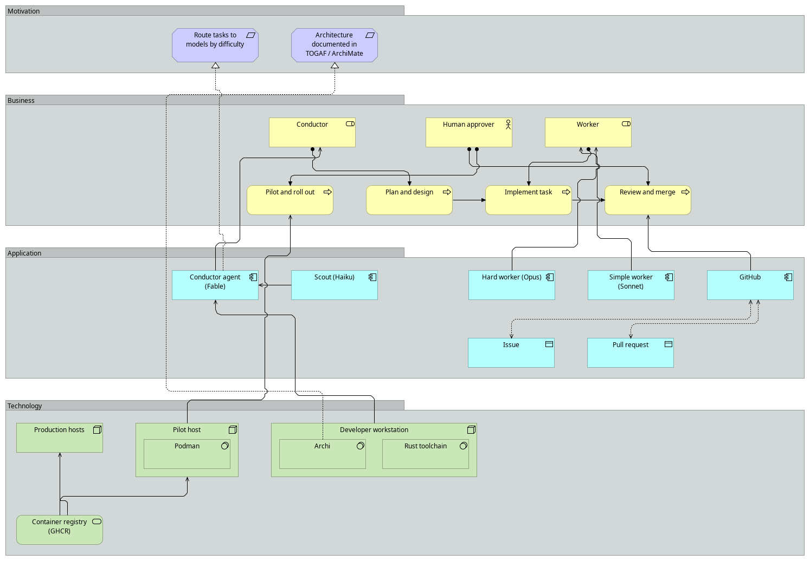
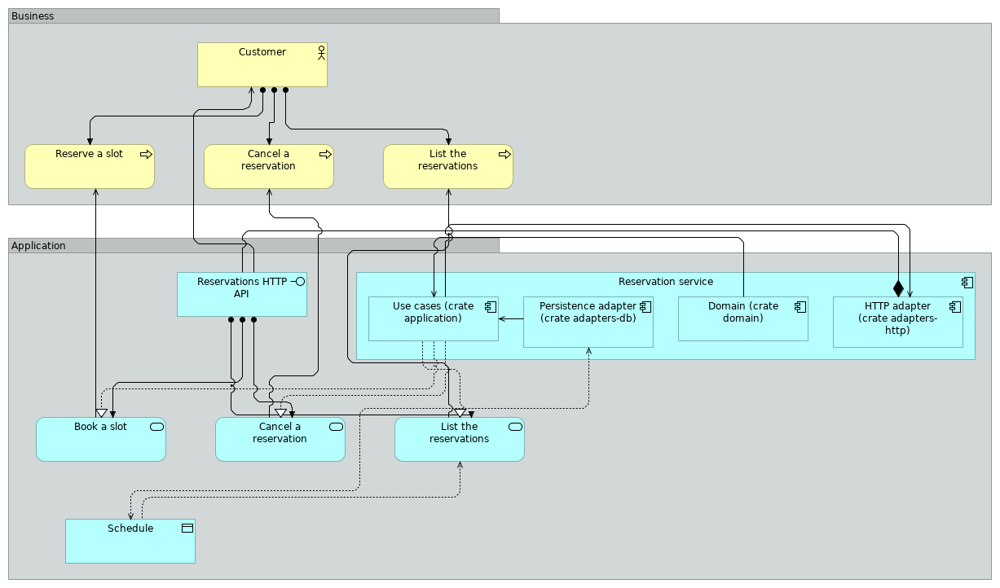

<!-- Generated from docs/architecture/model.xml (id-impl-del-information-systems-architecture) by `just model-docs`. Do not edit: change the model, see docs/togaf/template.md. -->
# C. Information Systems Architecture

**Purpose:** Describe the applications and data that support the business: components, interfaces,
data objects.

## Outputs
- Application components and their interfaces
- Data objects and ownership
- Mapping to Rust crates

## Content
Applications in the factory: conductor agent, hard / simple workers, scout, and GitHub (issues,
PRs). Data objects: issue ([`id-app-data-issue`](#id-app-data-issue)) and pull request
([`id-app-data-pr`](#id-app-data-pr)).

For a project, each application component maps to a crate in the Cargo workspace (domain,
application, adapters, app), and each data object to a domain type or table.

### Sample domain: reservations
The reservation service ([`id-app-comp-reservation-svc`](#id-app-comp-reservation-svc), crate `app`)
is composed of one component per crate, following ADR 0003: domain
([`id-app-comp-domain`](#id-app-comp-domain)), use cases
([`id-app-comp-application`](#id-app-comp-application)), HTTP adapter
([`id-app-comp-http`](#id-app-comp-http)) and persistence adapter
([`id-app-comp-db`](#id-app-comp-db)). The Serving relationships between these crate components show
the run-time call direction, not the Cargo dependency direction, which ADR 0003 governs. So
`id-rel-068` (the persistence adapter serves the use cases) is not a layering violation: at run time
the use cases call the adapter through their `ScheduleRepository` port, while in Cargo `adapters-db`
depends on `application` (dependency inversion).

Customers use the service through the reservations HTTP API
([`id-app-intf-reservation-api`](#id-app-intf-reservation-api)), which is part of the HTTP adapter.
The API offers three application services: book a slot ([`id-app-svc-book`](#id-app-svc-book)), from
epic #17 cancel a reservation ([`id-app-svc-cancel`](#id-app-svc-cancel)), and from epic #79 list
the reservations ([`id-app-svc-list`](#id-app-svc-list)). The data is the day's schedule
([`id-app-data-schedule`](#id-app-data-schedule)), which realises the reservation business object.

Cancelling is `DELETE /reservations/{id}`: `204 No Content` on success, `404 Not Found` with the
usual `{error}` body for an unknown or already cancelled id; a non-numeric id gets the framework's
plain-text `400`. The reservation is removed, not marked; see ADR 0007 for the options considered.
The domain rule already exists (`Schedule::cancel`); the change adds a use case and an HTTP route.

Listing is `GET /reservations`: `200 OK` with `{"reservations": [{"id", "start", "end"}]}`, times in
minutes since midnight as in booking, ordered by start time; an empty schedule gives an empty list,
not `404`. The list sits inside an object so that paging can be added later without breaking
clients. The domain guarantees the order (`Schedule::reservations()`), and the use case reads the
schedule through a read-only operation of the `ScheduleRepository` port beside `update`, so a list
never takes the write path; see ADR 0012
([`id-mot-adr-0012`](../adr/0012-list-reservations-by-get.md)). The contract goes from `1.0.0` to
`1.1.0` in the PR that adds the route.

The contract of the API is the OpenAPI 3.1 specification `docs/api/openapi.yaml`, written by hand:
every route, status code, content type and body, including the framework's plain-text rejections.
The acceptance check runs Schemathesis against the running container to prove that the service
answers as the file says, and a PR that changes HTTP behaviour changes the file with it; see ADR
0010 ([`id-mot-adr-0010`](../adr/0010-openapi-specification-spec-first.md), change request #60).

Every change to the schedule goes through one atomic `update` operation on the `ScheduleRepository`
port: reading, changing and storing the schedule happen as one step, and a change refused by a
business rule stores nothing. Concurrent requests therefore cannot lose, duplicate or bring back
reservations (bug #26, fixed by ADR 0008). Reads that change nothing use the port's read-only
operation (ADR 0012), which runs under the same lock and stores nothing. Each host still keeps its
own in-memory schedule.

## Open questions
- _none yet_

## Factory overview

Business, application and technology layers of the factory, top to bottom.

Clickable version:
[report](https://num-bbro.github.io/rust-factory/report/id-model-factory/views/id-view-layered.html)

| ID | Name | Type | Decisions | Issues | Crate / code | Release | Other documents |
|---|---|---|---|---|---|---|---|
| `id-app-comp-conductor` | Conductor agent (Fable) | ApplicationComponent | [ADR 0004](../adr/0004-agent-team-and-cost-routing.md) |  |  |  | [D. Technology Architecture](D-technology-architecture.md#id-app-comp-conductor) |
| `id-app-comp-github` | GitHub | ApplicationComponent |  |  |  |  | [D. Technology Architecture](D-technology-architecture.md#id-app-comp-github) |
| `id-app-comp-hard` | Hard worker (Opus) | ApplicationComponent | [ADR 0004](../adr/0004-agent-team-and-cost-routing.md) |  |  |  | [D. Technology Architecture](D-technology-architecture.md#id-app-comp-hard) |
| `id-app-comp-scout` | Scout (Haiku) | ApplicationComponent | [ADR 0004](../adr/0004-agent-team-and-cost-routing.md) |  |  |  | [D. Technology Architecture](D-technology-architecture.md#id-app-comp-scout) |
| `id-app-comp-simple` | Simple worker (Sonnet) | ApplicationComponent | [ADR 0004](../adr/0004-agent-team-and-cost-routing.md) |  |  |  | [D. Technology Architecture](D-technology-architecture.md#id-app-comp-simple) |
| `id-app-data-issue` | Issue | DataObject |  |  |  |  | [D. Technology Architecture](D-technology-architecture.md#id-app-data-issue) |
| `id-app-data-pr` | Pull request | DataObject |  |  |  |  | [D. Technology Architecture](D-technology-architecture.md#id-app-data-pr) |
| `id-bus-act-human` | Human approver | BusinessActor |  |  |  |  | [B. Business Architecture](B-business-architecture.md#id-bus-act-human), [D. Technology Architecture](D-technology-architecture.md#id-bus-act-human), [G. Implementation Governance](G-implementation-governance.md#id-bus-act-human) |
| `id-bus-proc-deploy` | Pilot and roll out | BusinessProcess | [ADR 0006](../adr/0006-pilot-and-rollout-with-quadlet.md) |  |  |  | [B. Business Architecture](B-business-architecture.md#id-bus-proc-deploy), [D. Technology Architecture](D-technology-architecture.md#id-bus-proc-deploy), [G. Implementation Governance](G-implementation-governance.md#id-bus-proc-deploy) |
| `id-bus-proc-implement` | Implement task | BusinessProcess |  |  |  |  | [B. Business Architecture](B-business-architecture.md#id-bus-proc-implement), [D. Technology Architecture](D-technology-architecture.md#id-bus-proc-implement), [G. Implementation Governance](G-implementation-governance.md#id-bus-proc-implement) |
| `id-bus-proc-plan` | Plan and design | BusinessProcess |  |  |  |  | [B. Business Architecture](B-business-architecture.md#id-bus-proc-plan), [D. Technology Architecture](D-technology-architecture.md#id-bus-proc-plan), [G. Implementation Governance](G-implementation-governance.md#id-bus-proc-plan) |
| `id-bus-proc-review` | Review and merge | BusinessProcess |  |  |  |  | [B. Business Architecture](B-business-architecture.md#id-bus-proc-review), [D. Technology Architecture](D-technology-architecture.md#id-bus-proc-review), [G. Implementation Governance](G-implementation-governance.md#id-bus-proc-review) |
| `id-bus-role-conductor` | Conductor | BusinessRole |  |  |  |  | [B. Business Architecture](B-business-architecture.md#id-bus-role-conductor), [D. Technology Architecture](D-technology-architecture.md#id-bus-role-conductor), [G. Implementation Governance](G-implementation-governance.md#id-bus-role-conductor) |
| `id-bus-role-worker` | Worker | BusinessRole |  |  |  |  | [B. Business Architecture](B-business-architecture.md#id-bus-role-worker), [D. Technology Architecture](D-technology-architecture.md#id-bus-role-worker), [G. Implementation Governance](G-implementation-governance.md#id-bus-role-worker) |
| `id-mot-req-routing` | Route tasks to models by difficulty | Requirement | [ADR 0004](../adr/0004-agent-team-and-cost-routing.md) |  |  |  | [Preliminary](00-preliminary.md#id-mot-req-routing), [A. Architecture Vision](A-architecture-vision.md#id-mot-req-routing), [D. Technology Architecture](D-technology-architecture.md#id-mot-req-routing) |
| `id-mot-req-togaf` | Architecture documented in TOGAF / ArchiMate | Requirement | [ADR 0002](../adr/0002-archimate-model-as-text.md), [ADR 0009](../adr/0009-archimate-exchange-model-as-source.md), [ADR 0011](../adr/0011-a-diagram-on-every-adr-page.md) |  |  |  | [Preliminary](00-preliminary.md#id-mot-req-togaf), [A. Architecture Vision](A-architecture-vision.md#id-mot-req-togaf), [D. Technology Architecture](D-technology-architecture.md#id-mot-req-togaf) |
| `id-tech-node-pilot` | Pilot host | Node | [ADR 0006](../adr/0006-pilot-and-rollout-with-quadlet.md) |  |  |  | [D. Technology Architecture](D-technology-architecture.md#id-tech-node-pilot) |
| `id-tech-node-prod` | Production hosts | Node | [ADR 0006](../adr/0006-pilot-and-rollout-with-quadlet.md) |  |  |  | [D. Technology Architecture](D-technology-architecture.md#id-tech-node-prod) |
| `id-tech-node-workstation` | Developer workstation | Node |  |  |  |  | [D. Technology Architecture](D-technology-architecture.md#id-tech-node-workstation) |
| `id-tech-svc-ghcr` | Container registry (GHCR) | TechnologyService | [ADR 0005](../adr/0005-release-image-and-acceptance.md) |  |  |  | [D. Technology Architecture](D-technology-architecture.md#id-tech-svc-ghcr) |
| `id-tech-sw-archi` | Archi | SystemSoftware | [ADR 0002](../adr/0002-archimate-model-as-text.md), [ADR 0009](../adr/0009-archimate-exchange-model-as-source.md), [ADR 0011](../adr/0011-a-diagram-on-every-adr-page.md) |  |  |  | [D. Technology Architecture](D-technology-architecture.md#id-tech-sw-archi) |
| `id-tech-sw-podman` | Podman | SystemSoftware | [ADR 0005](../adr/0005-release-image-and-acceptance.md), [ADR 0006](../adr/0006-pilot-and-rollout-with-quadlet.md) |  |  |  | [D. Technology Architecture](D-technology-architecture.md#id-tech-sw-podman) |
| `id-tech-sw-rust` | Rust toolchain | SystemSoftware | [ADR 0003](../adr/0003-layered-cargo-workspace.md) |  |  |  | [D. Technology Architecture](D-technology-architecture.md#id-tech-sw-rust) |

## Reservations 2/2: how (application)

Sample reservation domain, epics #17 and #79, part 2 of 2: the business processes (from part 1,
id-view-reservation-cancel) and the application that serves them: the API, the three application
services, the crates of the reservation service and the schedule. Technology is unchanged (see
id-view-layered).

Clickable version:
[report](https://num-bbro.github.io/rust-factory/report/id-model-factory/views/id-view-reservation-app.html)

| ID | Name | Type | Decisions | Issues | Crate / code | Release | Other documents |
|---|---|---|---|---|---|---|---|
| `id-app-comp-application` | Use cases (crate application) | ApplicationComponent | [ADR 0008](../adr/0008-atomic-schedule-update-through-the-port.md), [ADR 0012](../adr/0012-list-reservations-by-get.md) |  | `crates/application` | Release v0.1.0, Release v0.2.0, Release v0.2.1 |  |
| `id-app-comp-db` | Persistence adapter (crate adapters-db) | ApplicationComponent | [ADR 0008](../adr/0008-atomic-schedule-update-through-the-port.md), [ADR 0012](../adr/0012-list-reservations-by-get.md) |  | `crates/adapters-db` | Release v0.1.0, Release v0.2.1 |  |
| `id-app-comp-domain` | Domain (crate domain) | ApplicationComponent |  |  | `crates/domain` | Release v0.1.0 |  |
| `id-app-comp-http` | HTTP adapter (crate adapters-http) | ApplicationComponent |  |  | `crates/adapters-http` | Release v0.1.0, Release v0.2.0, Release v0.2.1 |  |
| `id-app-comp-reservation-svc` | Reservation service | ApplicationComponent | [ADR 0003](../adr/0003-layered-cargo-workspace.md) |  | `crates/app` | Release v0.1.0 |  |
| `id-app-data-schedule` | Schedule | DataObject | [ADR 0007](../adr/0007-cancel-reservation-by-delete.md), [ADR 0008](../adr/0008-atomic-schedule-update-through-the-port.md), [ADR 0012](../adr/0012-list-reservations-by-get.md) | #26 | `crates/domain`, `Schedule` | Release v0.1.0, Release v0.2.1 |  |
| `id-app-intf-reservation-api` | Reservations HTTP API | ApplicationInterface | [ADR 0007](../adr/0007-cancel-reservation-by-delete.md), [ADR 0010](../adr/0010-openapi-specification-spec-first.md), [ADR 0012](../adr/0012-list-reservations-by-get.md) |  |  | Release v0.1.0, Release v0.2.0 |  |
| `id-app-svc-book` | Book a slot | ApplicationService | [ADR 0010](../adr/0010-openapi-specification-spec-first.md) |  | `crates/application`, `BookSlot` | Release v0.1.0 | [A. Architecture Vision](A-architecture-vision.md#id-app-svc-book), [B. Business Architecture](B-business-architecture.md#id-app-svc-book), [Requirements Management](requirements-management.md#id-app-svc-book) |
| `id-app-svc-cancel` | Cancel a reservation | ApplicationService | [ADR 0007](../adr/0007-cancel-reservation-by-delete.md), [ADR 0010](../adr/0010-openapi-specification-spec-first.md) | #17 |  | Release v0.2.0 | [A. Architecture Vision](A-architecture-vision.md#id-app-svc-cancel), [B. Business Architecture](B-business-architecture.md#id-app-svc-cancel), [Requirements Management](requirements-management.md#id-app-svc-cancel) |
| `id-app-svc-list` | List the reservations | ApplicationService | [ADR 0010](../adr/0010-openapi-specification-spec-first.md), [ADR 0012](../adr/0012-list-reservations-by-get.md) | #79 | `crates/application`, `ListReservations` |  | [A. Architecture Vision](A-architecture-vision.md#id-app-svc-list), [B. Business Architecture](B-business-architecture.md#id-app-svc-list), [Requirements Management](requirements-management.md#id-app-svc-list) |
| `id-bus-act-customer` | Customer | BusinessActor |  |  |  |  | [A. Architecture Vision](A-architecture-vision.md#id-bus-act-customer), [B. Business Architecture](B-business-architecture.md#id-bus-act-customer), [Requirements Management](requirements-management.md#id-bus-act-customer) |
| `id-bus-proc-cancel` | Cancel a reservation | BusinessProcess | [ADR 0007](../adr/0007-cancel-reservation-by-delete.md) | #17 |  | Release v0.2.0 | [A. Architecture Vision](A-architecture-vision.md#id-bus-proc-cancel), [B. Business Architecture](B-business-architecture.md#id-bus-proc-cancel), [Requirements Management](requirements-management.md#id-bus-proc-cancel) |
| `id-bus-proc-list` | List the reservations | BusinessProcess | [ADR 0012](../adr/0012-list-reservations-by-get.md) | #79 |  |  | [A. Architecture Vision](A-architecture-vision.md#id-bus-proc-list), [B. Business Architecture](B-business-architecture.md#id-bus-proc-list), [Requirements Management](requirements-management.md#id-bus-proc-list) |
| `id-bus-proc-reserve` | Reserve a slot | BusinessProcess |  |  |  | Release v0.1.0 | [A. Architecture Vision](A-architecture-vision.md#id-bus-proc-reserve), [B. Business Architecture](B-business-architecture.md#id-bus-proc-reserve), [Requirements Management](requirements-management.md#id-bus-proc-reserve) |
