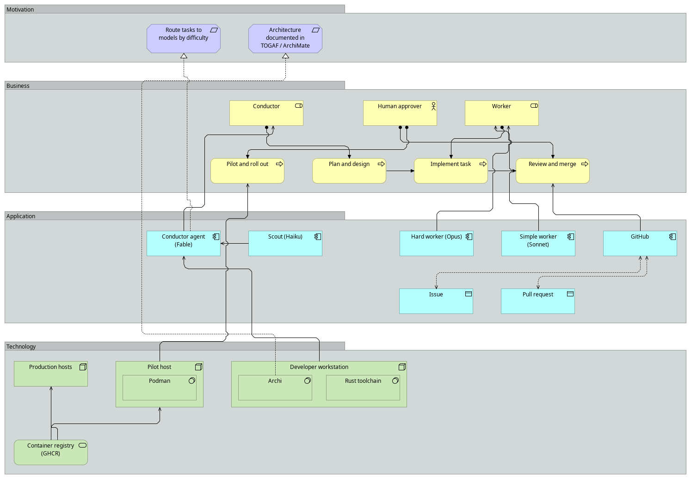

<!-- Generated from docs/architecture/model.xml (id-impl-del-technology-architecture) by `just model-docs`. Do not edit: change the model, see docs/togaf/template.md. -->
# D. Technology Architecture

**Purpose:** Describe the platforms the applications run on: nodes, system software, networks,
services.

## Outputs
- Nodes and environments (dev, pilot, production)
- System software
- Technology services

## Content
Factory technology: developer workstations (Arch / Ubuntu-WSL,
[`id-tech-node-workstation`](#id-tech-node-workstation)) with the pinned Rust toolchain and Archi;
release images in GHCR ([`id-tech-svc-ghcr`](#id-tech-svc-ghcr)); Podman on pilot and production
hosts.

The sample reservation service
([`id-app-comp-reservation-svc`](A-architecture-vision.md#id-app-comp-reservation-svc)) runs as a
container under Podman ([`id-tech-sw-podman`](#id-tech-sw-podman)) on the pilot host
([`id-tech-node-pilot`](#id-tech-node-pilot)) and production hosts. Epic #17 needs no technology
change.

## Open questions
- _none yet_

## Factory overview

Business, application and technology layers of the factory, top to bottom.

Clickable version:
[report](https://num-bbro.github.io/rust-factory/report/id-model-factory/views/id-view-layered.html)

| ID | Name | Type | Decisions | Issues | Crate / code | Release | Other documents |
|---|---|---|---|---|---|---|---|
| `id-app-comp-conductor` | Conductor agent (Fable) | ApplicationComponent | [ADR 0004](../adr/0004-agent-team-and-cost-routing.md) |  |  |  | [C. Information Systems Architecture](C-information-systems-architecture.md#id-app-comp-conductor) |
| `id-app-comp-github` | GitHub | ApplicationComponent |  |  |  |  | [C. Information Systems Architecture](C-information-systems-architecture.md#id-app-comp-github) |
| `id-app-comp-hard` | Hard worker (Opus) | ApplicationComponent | [ADR 0004](../adr/0004-agent-team-and-cost-routing.md) |  |  |  | [C. Information Systems Architecture](C-information-systems-architecture.md#id-app-comp-hard) |
| `id-app-comp-scout` | Scout (Haiku) | ApplicationComponent | [ADR 0004](../adr/0004-agent-team-and-cost-routing.md) |  |  |  | [C. Information Systems Architecture](C-information-systems-architecture.md#id-app-comp-scout) |
| `id-app-comp-simple` | Simple worker (Sonnet) | ApplicationComponent | [ADR 0004](../adr/0004-agent-team-and-cost-routing.md) |  |  |  | [C. Information Systems Architecture](C-information-systems-architecture.md#id-app-comp-simple) |
| `id-app-data-issue` | Issue | DataObject |  |  |  |  | [C. Information Systems Architecture](C-information-systems-architecture.md#id-app-data-issue) |
| `id-app-data-pr` | Pull request | DataObject |  |  |  |  | [C. Information Systems Architecture](C-information-systems-architecture.md#id-app-data-pr) |
| `id-bus-act-human` | Human approver | BusinessActor |  |  |  |  | [B. Business Architecture](B-business-architecture.md#id-bus-act-human), [C. Information Systems Architecture](C-information-systems-architecture.md#id-bus-act-human), [G. Implementation Governance](G-implementation-governance.md#id-bus-act-human) |
| `id-bus-proc-deploy` | Pilot and roll out | BusinessProcess | [ADR 0006](../adr/0006-pilot-and-rollout-with-quadlet.md) |  |  |  | [B. Business Architecture](B-business-architecture.md#id-bus-proc-deploy), [C. Information Systems Architecture](C-information-systems-architecture.md#id-bus-proc-deploy), [G. Implementation Governance](G-implementation-governance.md#id-bus-proc-deploy) |
| `id-bus-proc-implement` | Implement task | BusinessProcess |  |  |  |  | [B. Business Architecture](B-business-architecture.md#id-bus-proc-implement), [C. Information Systems Architecture](C-information-systems-architecture.md#id-bus-proc-implement), [G. Implementation Governance](G-implementation-governance.md#id-bus-proc-implement) |
| `id-bus-proc-plan` | Plan and design | BusinessProcess |  |  |  |  | [B. Business Architecture](B-business-architecture.md#id-bus-proc-plan), [C. Information Systems Architecture](C-information-systems-architecture.md#id-bus-proc-plan), [G. Implementation Governance](G-implementation-governance.md#id-bus-proc-plan) |
| `id-bus-proc-review` | Review and merge | BusinessProcess |  |  |  |  | [B. Business Architecture](B-business-architecture.md#id-bus-proc-review), [C. Information Systems Architecture](C-information-systems-architecture.md#id-bus-proc-review), [G. Implementation Governance](G-implementation-governance.md#id-bus-proc-review) |
| `id-bus-role-conductor` | Conductor | BusinessRole |  |  |  |  | [B. Business Architecture](B-business-architecture.md#id-bus-role-conductor), [C. Information Systems Architecture](C-information-systems-architecture.md#id-bus-role-conductor), [G. Implementation Governance](G-implementation-governance.md#id-bus-role-conductor) |
| `id-bus-role-worker` | Worker | BusinessRole |  |  |  |  | [B. Business Architecture](B-business-architecture.md#id-bus-role-worker), [C. Information Systems Architecture](C-information-systems-architecture.md#id-bus-role-worker), [G. Implementation Governance](G-implementation-governance.md#id-bus-role-worker) |
| `id-mot-req-routing` | Route tasks to models by difficulty | Requirement | [ADR 0004](../adr/0004-agent-team-and-cost-routing.md) |  |  |  | [Preliminary](00-preliminary.md#id-mot-req-routing), [A. Architecture Vision](A-architecture-vision.md#id-mot-req-routing), [C. Information Systems Architecture](C-information-systems-architecture.md#id-mot-req-routing) |
| `id-mot-req-togaf` | Architecture documented in TOGAF / ArchiMate | Requirement | [ADR 0002](../adr/0002-archimate-model-as-text.md), [ADR 0009](../adr/0009-archimate-exchange-model-as-source.md), [ADR 0011](../adr/0011-a-diagram-on-every-adr-page.md) |  |  |  | [Preliminary](00-preliminary.md#id-mot-req-togaf), [A. Architecture Vision](A-architecture-vision.md#id-mot-req-togaf), [C. Information Systems Architecture](C-information-systems-architecture.md#id-mot-req-togaf) |
| `id-tech-node-pilot` | Pilot host | Node | [ADR 0006](../adr/0006-pilot-and-rollout-with-quadlet.md) |  |  |  | [C. Information Systems Architecture](C-information-systems-architecture.md#id-tech-node-pilot) |
| `id-tech-node-prod` | Production hosts | Node | [ADR 0006](../adr/0006-pilot-and-rollout-with-quadlet.md) |  |  |  | [C. Information Systems Architecture](C-information-systems-architecture.md#id-tech-node-prod) |
| `id-tech-node-workstation` | Developer workstation | Node |  |  |  |  | [C. Information Systems Architecture](C-information-systems-architecture.md#id-tech-node-workstation) |
| `id-tech-svc-ghcr` | Container registry (GHCR) | TechnologyService | [ADR 0005](../adr/0005-release-image-and-acceptance.md) |  |  |  | [C. Information Systems Architecture](C-information-systems-architecture.md#id-tech-svc-ghcr) |
| `id-tech-sw-archi` | Archi | SystemSoftware | [ADR 0002](../adr/0002-archimate-model-as-text.md), [ADR 0009](../adr/0009-archimate-exchange-model-as-source.md), [ADR 0011](../adr/0011-a-diagram-on-every-adr-page.md) |  |  |  | [C. Information Systems Architecture](C-information-systems-architecture.md#id-tech-sw-archi) |
| `id-tech-sw-podman` | Podman | SystemSoftware | [ADR 0005](../adr/0005-release-image-and-acceptance.md), [ADR 0006](../adr/0006-pilot-and-rollout-with-quadlet.md) |  |  |  | [C. Information Systems Architecture](C-information-systems-architecture.md#id-tech-sw-podman) |
| `id-tech-sw-rust` | Rust toolchain | SystemSoftware | [ADR 0003](../adr/0003-layered-cargo-workspace.md) |  |  |  | [C. Information Systems Architecture](C-information-systems-architecture.md#id-tech-sw-rust) |
