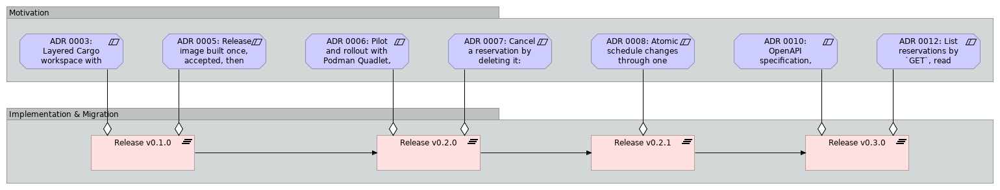

<!-- Generated from docs/architecture/model.xml (id-impl-del-migration-planning) by `just model-docs`. Do not edit: change the model, see docs/togaf/template.md. -->
# F. Migration Planning

**Purpose:** Plan the sequence of releases from current to target state, and how each is rolled out.

## Outputs
- Release plan (milestones)
- Pilot plan and success criteria
- Rollback plan

## Content
Each release is built once as a container image, accepted, deployed to the pilot host, and rolled
out to production after human approval. Rollback means redeploying the previous image tag.

## Open questions
- _none yet_

## Releases

What each release delivered.

| ID | Name | Type | Decisions | Issues | Crate / code | Release | Other documents |
|---|---|---|---|---|---|---|---|
| `id-app-comp-application` | Use cases (crate application) | ApplicationComponent | [ADR 0008](../adr/0008-atomic-schedule-update-through-the-port.md) |  | `crates/application` | Release vv0.1.0, Release vv0.2.0, Release vv0.2.1 | [A. Architecture Vision](A-architecture-vision.md#id-app-comp-application), [B. Business Architecture](B-business-architecture.md#id-app-comp-application), [C. Information Systems Architecture](C-information-systems-architecture.md#id-app-comp-application), [Requirements Management](requirements-management.md#id-app-comp-application) |
| `id-app-comp-db` | Persistence adapter (crate adapters-db) | ApplicationComponent | [ADR 0008](../adr/0008-atomic-schedule-update-through-the-port.md) |  | `crates/adapters-db` | Release vv0.1.0, Release vv0.2.1 | [A. Architecture Vision](A-architecture-vision.md#id-app-comp-db), [B. Business Architecture](B-business-architecture.md#id-app-comp-db), [C. Information Systems Architecture](C-information-systems-architecture.md#id-app-comp-db), [Requirements Management](requirements-management.md#id-app-comp-db) |
| `id-app-comp-domain` | Domain (crate domain) | ApplicationComponent |  |  | `crates/domain` | Release vv0.1.0 | [A. Architecture Vision](A-architecture-vision.md#id-app-comp-domain), [B. Business Architecture](B-business-architecture.md#id-app-comp-domain), [C. Information Systems Architecture](C-information-systems-architecture.md#id-app-comp-domain), [Requirements Management](requirements-management.md#id-app-comp-domain) |
| `id-app-comp-http` | HTTP adapter (crate adapters-http) | ApplicationComponent |  |  | `crates/adapters-http` | Release vv0.1.0, Release vv0.2.0 | [A. Architecture Vision](A-architecture-vision.md#id-app-comp-http), [B. Business Architecture](B-business-architecture.md#id-app-comp-http), [C. Information Systems Architecture](C-information-systems-architecture.md#id-app-comp-http), [Requirements Management](requirements-management.md#id-app-comp-http) |
| `id-app-comp-reservation-svc` | Reservation service | ApplicationComponent | [ADR 0003](../adr/0003-layered-cargo-workspace.md) |  | `crates/app` | Release vv0.1.0 | [A. Architecture Vision](A-architecture-vision.md#id-app-comp-reservation-svc), [B. Business Architecture](B-business-architecture.md#id-app-comp-reservation-svc), [C. Information Systems Architecture](C-information-systems-architecture.md#id-app-comp-reservation-svc), [Requirements Management](requirements-management.md#id-app-comp-reservation-svc) |
| `id-app-data-schedule` | Schedule | DataObject | [ADR 0007](../adr/0007-cancel-reservation-by-delete.md), [ADR 0008](../adr/0008-atomic-schedule-update-through-the-port.md) | #26 | `crates/domain`, `Schedule` | Release vv0.1.0, Release vv0.2.1 | [A. Architecture Vision](A-architecture-vision.md#id-app-data-schedule), [B. Business Architecture](B-business-architecture.md#id-app-data-schedule), [C. Information Systems Architecture](C-information-systems-architecture.md#id-app-data-schedule), [Requirements Management](requirements-management.md#id-app-data-schedule) |
| `id-app-intf-reservation-api` | Reservations HTTP API | ApplicationInterface | [ADR 0007](../adr/0007-cancel-reservation-by-delete.md) |  |  | Release vv0.1.0, Release vv0.2.0 | [A. Architecture Vision](A-architecture-vision.md#id-app-intf-reservation-api), [B. Business Architecture](B-business-architecture.md#id-app-intf-reservation-api), [C. Information Systems Architecture](C-information-systems-architecture.md#id-app-intf-reservation-api), [Requirements Management](requirements-management.md#id-app-intf-reservation-api) |
| `id-app-svc-book` | Book a slot | ApplicationService |  |  | `crates/application`, `BookSlot` | Release vv0.1.0 | [A. Architecture Vision](A-architecture-vision.md#id-app-svc-book), [B. Business Architecture](B-business-architecture.md#id-app-svc-book), [C. Information Systems Architecture](C-information-systems-architecture.md#id-app-svc-book), [Requirements Management](requirements-management.md#id-app-svc-book) |
| `id-app-svc-cancel` | Cancel a reservation | ApplicationService | [ADR 0007](../adr/0007-cancel-reservation-by-delete.md) | #17 |  | Release vv0.2.0 | [A. Architecture Vision](A-architecture-vision.md#id-app-svc-cancel), [B. Business Architecture](B-business-architecture.md#id-app-svc-cancel), [C. Information Systems Architecture](C-information-systems-architecture.md#id-app-svc-cancel), [Requirements Management](requirements-management.md#id-app-svc-cancel) |
| `id-impl-plat-v0-1-0` | Release vv0.1.0 | Plateau |  |  |  |  |  |
| `id-impl-plat-v0-2-0` | Release vv0.2.0 | Plateau |  |  |  |  |  |
| `id-impl-plat-v0-2-1` | Release vv0.2.1 | Plateau |  |  |  |  |  |
| `id-mot-adr-0003` | ADR 0003: Layered Cargo workspace with enforced dependency direction | Constraint |  | #5 |  | Release vv0.1.0 |  |
| `id-mot-adr-0005` | ADR 0005: Release image built once, accepted, then promoted unchanged | Constraint |  | #12 |  | Release vv0.1.0 |  |
| `id-mot-adr-0007` | ADR 0007: Cancel a reservation by deleting it: \`DELETE /reservations/{id}\` | Constraint |  | #17 (stories #18, #19) |  | Release vv0.2.0 |  |
| `id-mot-adr-0008` | ADR 0008: Atomic schedule changes through one \`update\` operation on the repository port | Constraint |  | #26 (bug), #37 (task) |  | Release vv0.2.1 |  |
