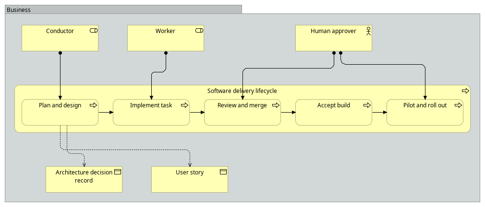

<!-- Generated from docs/architecture/model.xml (id-impl-del-implementation-governance) by `just model-docs`. Do not edit: change the model, see docs/togaf/template.md. -->
# G. Implementation Governance

**Purpose:** Make sure what is built matches the architecture.

## Outputs
- Architecture compliance checks
- Review process
- Quality gates

## Content
Governance runs on every PR: the PR template links the issue, ADR and ArchiMate elements; automated
gates (format, lint, tests, architecture test, model build) must pass; the reviewer agent checks
architecture compliance; a human merges.

## Open questions
- _none yet_

## Delivery lifecycle

Who does what in the delivery lifecycle.

Clickable version:
[report](https://num-bbro.github.io/rust-factory/report/id-model-factory/views/id-view-lifecycle.html)

| ID | Name | Type | Decisions | Issues | Crate / code | Release | Other documents |
|---|---|---|---|---|---|---|---|
| `id-bus-act-human` | Human approver | BusinessActor |  |  |  |  | [B. Business Architecture](B-business-architecture.md#id-bus-act-human), [C. Information Systems Architecture](C-information-systems-architecture.md#id-bus-act-human), [D. Technology Architecture](D-technology-architecture.md#id-bus-act-human) |
| `id-bus-obj-adr` | Architecture decision record | BusinessObject | [ADR 0001](../adr/0001-record-architecture-decisions.md) |  |  |  | [B. Business Architecture](B-business-architecture.md#id-bus-obj-adr) |
| `id-bus-obj-story` | User story | BusinessObject |  |  |  |  | [B. Business Architecture](B-business-architecture.md#id-bus-obj-story) |
| `id-bus-proc-accept` | Accept build | BusinessProcess | [ADR 0005](../adr/0005-release-image-and-acceptance.md) |  |  |  | [B. Business Architecture](B-business-architecture.md#id-bus-proc-accept) |
| `id-bus-proc-deploy` | Pilot and roll out | BusinessProcess | [ADR 0006](../adr/0006-pilot-and-rollout-with-quadlet.md) |  |  |  | [B. Business Architecture](B-business-architecture.md#id-bus-proc-deploy), [C. Information Systems Architecture](C-information-systems-architecture.md#id-bus-proc-deploy), [D. Technology Architecture](D-technology-architecture.md#id-bus-proc-deploy) |
| `id-bus-proc-implement` | Implement task | BusinessProcess |  |  |  |  | [B. Business Architecture](B-business-architecture.md#id-bus-proc-implement), [C. Information Systems Architecture](C-information-systems-architecture.md#id-bus-proc-implement), [D. Technology Architecture](D-technology-architecture.md#id-bus-proc-implement) |
| `id-bus-proc-lifecycle` | Software delivery lifecycle | BusinessProcess |  |  |  |  | [B. Business Architecture](B-business-architecture.md#id-bus-proc-lifecycle) |
| `id-bus-proc-plan` | Plan and design | BusinessProcess |  |  |  |  | [B. Business Architecture](B-business-architecture.md#id-bus-proc-plan), [C. Information Systems Architecture](C-information-systems-architecture.md#id-bus-proc-plan), [D. Technology Architecture](D-technology-architecture.md#id-bus-proc-plan) |
| `id-bus-proc-review` | Review and merge | BusinessProcess |  |  |  |  | [B. Business Architecture](B-business-architecture.md#id-bus-proc-review), [C. Information Systems Architecture](C-information-systems-architecture.md#id-bus-proc-review), [D. Technology Architecture](D-technology-architecture.md#id-bus-proc-review) |
| `id-bus-role-conductor` | Conductor | BusinessRole |  |  |  |  | [B. Business Architecture](B-business-architecture.md#id-bus-role-conductor), [C. Information Systems Architecture](C-information-systems-architecture.md#id-bus-role-conductor), [D. Technology Architecture](D-technology-architecture.md#id-bus-role-conductor) |
| `id-bus-role-worker` | Worker | BusinessRole |  |  |  |  | [B. Business Architecture](B-business-architecture.md#id-bus-role-worker), [C. Information Systems Architecture](C-information-systems-architecture.md#id-bus-role-worker), [D. Technology Architecture](D-technology-architecture.md#id-bus-role-worker) |
