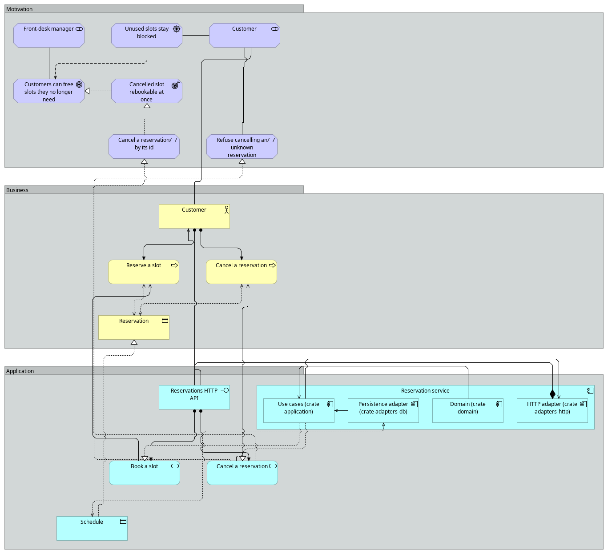

<!-- Generated from docs/architecture/model.xml (id-impl-del-requirements-management) by `just model-docs`. Do not edit: change the model, see docs/togaf/template.md. -->
# Requirements Management

**Purpose:** Keep requirements visible, prioritised and traceable through every phase.

## Outputs
- Requirement and story issues
- Priorities (MoSCoW)
- Traceability links

## Content
Requirements live as GitHub issues (forms in `.github/ISSUE_TEMPLATE/`), prioritised with MoSCoW
labels and tracked on the Project board through Backlog → Released. Important requirements are also
ArchiMate Requirement elements, linked to the elements that realise them.

Sample domain: the stories of epic #17 are requirements in the model, so the chain story →
requirement → application service is visible in
[`id-view-reservation-cancel`](#id-view-reservation-cancel): #18 is
[`id-mot-req-cancel`](#id-mot-req-cancel), #19 is
[`id-mot-req-cancel-refused`](#id-mot-req-cancel-refused), both realised by
[`id-app-svc-cancel`](#id-app-svc-cancel).

## Open questions
- _none yet_

## Reservations: cancel a reservation

Sample reservation domain, epic #17: why customers cancel, the business processes, and the crates
and API that serve them. Technology is unchanged (see id-view-layered).

| ID | Name | Type | Decisions | Issues | Crate / code | Release | Other documents |
|---|---|---|---|---|---|---|---|
| `id-app-comp-application` | Use cases (crate application) | ApplicationComponent | [ADR 0008](../adr/0008-atomic-schedule-update-through-the-port.md) |  | `crates/application` | Release vv0.1.0, Release vv0.2.0, Release vv0.2.1 | [A. Architecture Vision](A-architecture-vision.md#id-app-comp-application), [B. Business Architecture](B-business-architecture.md#id-app-comp-application), [C. Information Systems Architecture](C-information-systems-architecture.md#id-app-comp-application), [F. Migration Planning](F-migration-planning.md#id-app-comp-application) |
| `id-app-comp-db` | Persistence adapter (crate adapters-db) | ApplicationComponent | [ADR 0008](../adr/0008-atomic-schedule-update-through-the-port.md) |  | `crates/adapters-db` | Release vv0.1.0, Release vv0.2.1 | [A. Architecture Vision](A-architecture-vision.md#id-app-comp-db), [B. Business Architecture](B-business-architecture.md#id-app-comp-db), [C. Information Systems Architecture](C-information-systems-architecture.md#id-app-comp-db), [F. Migration Planning](F-migration-planning.md#id-app-comp-db) |
| `id-app-comp-domain` | Domain (crate domain) | ApplicationComponent |  |  | `crates/domain` | Release vv0.1.0 | [A. Architecture Vision](A-architecture-vision.md#id-app-comp-domain), [B. Business Architecture](B-business-architecture.md#id-app-comp-domain), [C. Information Systems Architecture](C-information-systems-architecture.md#id-app-comp-domain), [F. Migration Planning](F-migration-planning.md#id-app-comp-domain) |
| `id-app-comp-http` | HTTP adapter (crate adapters-http) | ApplicationComponent |  |  | `crates/adapters-http` | Release vv0.1.0, Release vv0.2.0 | [A. Architecture Vision](A-architecture-vision.md#id-app-comp-http), [B. Business Architecture](B-business-architecture.md#id-app-comp-http), [C. Information Systems Architecture](C-information-systems-architecture.md#id-app-comp-http), [F. Migration Planning](F-migration-planning.md#id-app-comp-http) |
| `id-app-comp-reservation-svc` | Reservation service | ApplicationComponent | [ADR 0003](../adr/0003-layered-cargo-workspace.md) |  | `crates/app` | Release vv0.1.0 | [A. Architecture Vision](A-architecture-vision.md#id-app-comp-reservation-svc), [B. Business Architecture](B-business-architecture.md#id-app-comp-reservation-svc), [C. Information Systems Architecture](C-information-systems-architecture.md#id-app-comp-reservation-svc), [F. Migration Planning](F-migration-planning.md#id-app-comp-reservation-svc) |
| `id-app-data-schedule` | Schedule | DataObject | [ADR 0007](../adr/0007-cancel-reservation-by-delete.md), [ADR 0008](../adr/0008-atomic-schedule-update-through-the-port.md) | #26 | `crates/domain`, `Schedule` | Release vv0.1.0, Release vv0.2.1 | [A. Architecture Vision](A-architecture-vision.md#id-app-data-schedule), [B. Business Architecture](B-business-architecture.md#id-app-data-schedule), [C. Information Systems Architecture](C-information-systems-architecture.md#id-app-data-schedule), [F. Migration Planning](F-migration-planning.md#id-app-data-schedule) |
| `id-app-intf-reservation-api` | Reservations HTTP API | ApplicationInterface | [ADR 0007](../adr/0007-cancel-reservation-by-delete.md) |  |  | Release vv0.1.0, Release vv0.2.0 | [A. Architecture Vision](A-architecture-vision.md#id-app-intf-reservation-api), [B. Business Architecture](B-business-architecture.md#id-app-intf-reservation-api), [C. Information Systems Architecture](C-information-systems-architecture.md#id-app-intf-reservation-api), [F. Migration Planning](F-migration-planning.md#id-app-intf-reservation-api) |
| `id-app-svc-book` | Book a slot | ApplicationService |  |  | `crates/application`, `BookSlot` | Release vv0.1.0 | [A. Architecture Vision](A-architecture-vision.md#id-app-svc-book), [B. Business Architecture](B-business-architecture.md#id-app-svc-book), [C. Information Systems Architecture](C-information-systems-architecture.md#id-app-svc-book), [F. Migration Planning](F-migration-planning.md#id-app-svc-book) |
| `id-app-svc-cancel` | Cancel a reservation | ApplicationService | [ADR 0007](../adr/0007-cancel-reservation-by-delete.md) | #17 |  | Release vv0.2.0 | [A. Architecture Vision](A-architecture-vision.md#id-app-svc-cancel), [B. Business Architecture](B-business-architecture.md#id-app-svc-cancel), [C. Information Systems Architecture](C-information-systems-architecture.md#id-app-svc-cancel), [F. Migration Planning](F-migration-planning.md#id-app-svc-cancel) |
| `id-bus-act-customer` | Customer | BusinessActor |  |  |  |  | [A. Architecture Vision](A-architecture-vision.md#id-bus-act-customer), [B. Business Architecture](B-business-architecture.md#id-bus-act-customer), [C. Information Systems Architecture](C-information-systems-architecture.md#id-bus-act-customer) |
| `id-bus-obj-reservation` | Reservation | BusinessObject |  |  |  | Release vv0.1.0 | [A. Architecture Vision](A-architecture-vision.md#id-bus-obj-reservation), [B. Business Architecture](B-business-architecture.md#id-bus-obj-reservation), [C. Information Systems Architecture](C-information-systems-architecture.md#id-bus-obj-reservation) |
| `id-bus-proc-cancel` | Cancel a reservation | BusinessProcess | [ADR 0007](../adr/0007-cancel-reservation-by-delete.md) | #17 |  | Release vv0.2.0 | [A. Architecture Vision](A-architecture-vision.md#id-bus-proc-cancel), [B. Business Architecture](B-business-architecture.md#id-bus-proc-cancel), [C. Information Systems Architecture](C-information-systems-architecture.md#id-bus-proc-cancel) |
| `id-bus-proc-reserve` | Reserve a slot | BusinessProcess |  |  |  | Release vv0.1.0 | [A. Architecture Vision](A-architecture-vision.md#id-bus-proc-reserve), [B. Business Architecture](B-business-architecture.md#id-bus-proc-reserve), [C. Information Systems Architecture](C-information-systems-architecture.md#id-bus-proc-reserve) |
| `id-mot-drv-blocked-slots` | Unused slots stay blocked | Driver |  | #17 |  |  | [A. Architecture Vision](A-architecture-vision.md#id-mot-drv-blocked-slots), [B. Business Architecture](B-business-architecture.md#id-mot-drv-blocked-slots), [C. Information Systems Architecture](C-information-systems-architecture.md#id-mot-drv-blocked-slots) |
| `id-mot-goal-free-slots` | Customers can free slots they no longer need | Goal |  |  |  | Release vv0.2.0 | [A. Architecture Vision](A-architecture-vision.md#id-mot-goal-free-slots), [B. Business Architecture](B-business-architecture.md#id-mot-goal-free-slots), [C. Information Systems Architecture](C-information-systems-architecture.md#id-mot-goal-free-slots) |
| `id-mot-out-rebook` | Cancelled slot rebookable at once | Outcome | [ADR 0007](../adr/0007-cancel-reservation-by-delete.md) | #17 |  | Release vv0.2.0 | [A. Architecture Vision](A-architecture-vision.md#id-mot-out-rebook), [B. Business Architecture](B-business-architecture.md#id-mot-out-rebook), [C. Information Systems Architecture](C-information-systems-architecture.md#id-mot-out-rebook) |
| `id-mot-req-cancel` | Cancel a reservation by its id | Requirement | [ADR 0007](../adr/0007-cancel-reservation-by-delete.md) | #18 |  | Release vv0.2.0 | [A. Architecture Vision](A-architecture-vision.md#id-mot-req-cancel), [B. Business Architecture](B-business-architecture.md#id-mot-req-cancel), [C. Information Systems Architecture](C-information-systems-architecture.md#id-mot-req-cancel) |
| `id-mot-req-cancel-refused` | Refuse cancelling an unknown reservation | Requirement | [ADR 0007](../adr/0007-cancel-reservation-by-delete.md) | #19 |  | Release vv0.2.0 | [A. Architecture Vision](A-architecture-vision.md#id-mot-req-cancel-refused), [B. Business Architecture](B-business-architecture.md#id-mot-req-cancel-refused), [C. Information Systems Architecture](C-information-systems-architecture.md#id-mot-req-cancel-refused) |
| `id-mot-sh-customer` | Customer | Stakeholder |  |  |  |  | [A. Architecture Vision](A-architecture-vision.md#id-mot-sh-customer), [B. Business Architecture](B-business-architecture.md#id-mot-sh-customer), [C. Information Systems Architecture](C-information-systems-architecture.md#id-mot-sh-customer) |
| `id-mot-sh-front-desk` | Front-desk manager | Stakeholder |  |  |  |  | [A. Architecture Vision](A-architecture-vision.md#id-mot-sh-front-desk), [B. Business Architecture](B-business-architecture.md#id-mot-sh-front-desk), [C. Information Systems Architecture](C-information-systems-architecture.md#id-mot-sh-front-desk) |
